# MarketMaster Academy
> **Unified Digital Financial University & Institutional Market Simulation Ecosystem**

MarketMaster Academy combines a 6-tier comprehensive financial education curriculum (Level 0 through Level 5) with a high-fidelity paper trading terminal, historical candle replay engine, algorithmic execution sandbox, and a native Android application—operating under a strict ₹0 infrastructure budget.

---

## Current Build & Implementation Status

```mermaid
flowchart LR
    Phase0["Phase 0: Specifications<br/>✅ Complete (58 Docs)"] --> Phase1["Phase 1: Core Scaffolding<br/>🟡 In Progress (Sprint 1-2)"]
    Phase1 --> Phase2["Phase 2: Replay & Matching<br/>⚪ Scheduled (Sprint 3-4)"]
    Phase2 --> Phase3["Phase 3: ChartingPark Gym<br/>⚪ Scheduled (Sprint 5-6)"]
    Phase3 --> Phase4["Phase 4: Strategy Lab<br/>⚪ Scheduled (Sprint 7-8)"]
    Phase4 --> Phase5["Phase 5: Android APK<br/>⚪ Scheduled (Sprint 9-10)"]

    style Phase0 fill:#1e3a1e,stroke:#4caf50,stroke-width:2px,color:#ffffff
    style Phase1 fill:#3d2f0a,stroke:#ff9800,stroke-width:2px,color:#ffffff
    style Phase2 fill:#1f2937,stroke:#6b7280,stroke-width:1px,color:#cccccc
    style Phase3 fill:#1f2937,stroke:#6b7280,stroke-width:1px,color:#cccccc
    style Phase4 fill:#1f2937,stroke:#6b7280,stroke-width:1px,color:#cccccc
    style Phase5 fill:#1f2937,stroke:#6b7280,stroke-width:1px,color:#cccccc
```



| Subsystem | Tech Stack | Status | Reference Spec |
| :--- | :--- | :---: | :--- |
| **Specifications & Blueprints** | Markdown, Mermaid, IEEE 830 | ✅ Complete | [`docs/ROADMAP.md`](docs/ROADMAP.md) |
| **Frontend Web Terminal** | React 19, TanStack Start/Router, Tailwind v4, shadcn/ui | ✅ Active (15/15 Tests Pass) | [`docs/FRONTEND_ARCHITECTURE.md`](docs/FRONTEND_ARCHITECTURE.md) |
| **Backend & Quant Engine** | Python 3.13+, FastAPI, Polars, Async SQLAlchemy, NumPy, SciPy | ✅ Tested (15/15 Pass) | [`docs/BACKEND_ARCHITECTURE.md`](docs/BACKEND_ARCHITECTURE.md) |
| **Database & Caching** | PostgreSQL 16, SQLite (aiosqlite), Redis 7 Docker compose | ✅ Implemented | [`docs/DATABASE_SCHEMA.md`](docs/DATABASE_SCHEMA.md) |
| **Simulation & Replay Engine** | Non-Linear Power-Law Slippage, Indian Taxes, Double-Entry Ledger | ✅ Tested (100% Pass) | [`docs/PAPER_TRADING_ENGINE_SPEC.md`](docs/PAPER_TRADING_ENGINE_SPEC.md) |
| **Rated Gym & Glicko-2 Elo** | Daily Setups Rotation, Mandatory Rule 4.3 Stop-Loss ($R \le 1.5\%$) | ✅ Implemented | [`frontend/src/routes/challenges.tsx`](frontend/src/routes/challenges.tsx) |
| **Multi-Leg Options Builder** | Interactive Expiry Payoff Curve, SEBI Margin Relief Engine | ✅ Tested (100% Pass) | [`frontend/src/components/trading/OptionsStrategyBuilder.tsx`](frontend/src/components/trading/OptionsStrategyBuilder.tsx) |
| **Institutional Execution** | TWAP, VWAP intraday U-curve, Iceberg Queue, Cash & Carry Arbitrage | ✅ Tested (100% Pass) | [`frontend/src/components/trading/InstitutionalExecutionAlgorithms.tsx`](frontend/src/components/trading/InstitutionalExecutionAlgorithms.tsx) |
| **Mobile Android App** | Android Native Container (Kotlin, WebView, Offline Bundle) | ✅ 67 Assets Synced | [`docs/ANDROID_ARCHITECTURE.md`](docs/ANDROID_ARCHITECTURE.md) |
| **CI/CD & Cloud Hosting** | GitHub Actions Pipeline, Render & Vercel Free-Tier Configs | ✅ Active (.github/workflows/ci.yml) | [`render.yaml`](render.yaml) |

---

## Documentation Synchronization & Strategic Enhancement Suite

### Part 1: Documentation Updates Completed

| Document | Nature of Update | Direct Link |
| :--- | :--- | :--- |
| **`README.md`** | Added Live Implementation Status Dashboard, monorepo directory layout (`frontend/`, `backend/`, `android/`, `docker/`), and Developer Quickstart guide. | [`README.md`](README.md) |
| **`docs/ROADMAP.md`** | Synchronized milestones: demarcated Phase 0 (100% complete architecture) from Phase 1 (active code scaffolding sprint) and Phases 2–5 (scheduled). Added progress flowcharts and status matrices. | [`docs/ROADMAP.md`](docs/ROADMAP.md) |
| **`docs/CONTRIBUTING.md`** | Rebuilt into an actionable developer onboarding guide: Git branching rules, Conventional Commits, clean architecture rules, and pre-PR verification checklists. | [`docs/CONTRIBUTING.md`](docs/CONTRIBUTING.md) |
| **`docs/PROJECT_IMPROVEMENT_PROPOSALS.md`** | New specification: Deep strategic proposals across pedagogy, market realism, performance, gamification, and compliance. | [`docs/PROJECT_IMPROVEMENT_PROPOSALS.md`](docs/PROJECT_IMPROVEMENT_PROPOSALS.md) |
| **`docs/decision.md`** | Appended ADR-011 (Active Build Phase Scaffolding & Milestone Tracking) and ADR-012 (Adoption of Strategic Improvement Proposals) per Rule 7.1. | [`docs/decision.md`](docs/decision.md) |
| **`docs/changes.md`** | Fixed legacy directory path references and logged release entry `v1.0.8-DOCS-BUILD-UPDATE-AND-RECOMMENDATIONS` per Rule 7.2. | [`docs/changes.md`](docs/changes.md) |

### Part 2: Strategic Recommendations to Make the Project Better in All Ways

The proposed enhancements are codified in [`docs/PROJECT_IMPROVEMENT_PROPOSALS.md`](docs/PROJECT_IMPROVEMENT_PROPOSALS.md). A summary of the highest-impact improvements across all dimensions includes:

#### 1. Pedagogy & Trader Psychology (The Learning Engine)
* **Automated Trade Post-Mortem & Mistake Journal**: After every paper trade or replay session, automatically prompt a post-mortem modal evaluating whether the trader adhered to their plan (e.g., `#RevengeTrade`, `#MovedStopLossFurther`, `#CutWinnerEarly`). Generate a personal Mistake Heatmap showing where capital is lost.
* **Spaced Repetition (SM-2 Algorithm)**: Integrate client-side spaced repetition flashcards for all 200+ micro-concepts to resurface topics (e.g., Delta-neutral hedging, Wyckoff accumulation) at optimal retention intervals (1, 3, 7, and 21 days).
* **Real-time Discipline Index (0–100)**: Calculate a live psychological discipline score. If a user suffers losses and begins revenge trading within 30 seconds or aggressively scales into a falling knife without a plan, trigger a mandatory 5-minute Cool-Down Breathing Mode.

#### 2. Market Realism & Microstructure (The Financial Simulator)
* **Microstructure Latency Jitter (5ms–50ms)**: Introduce realistic network ping jitter and queue slippage during fast markets (e.g., RBI rate announcements or budget days) to teach users why market orders in volatile tapes cause adverse fills.
* **FIFO Level-3 Queue Priority**: Track the number of contracts ahead of limit orders at the bid/ask. The order only executes once preceding depth volume is consumed, eliminating optimistic fill bias.
* **Historical News Catalyst Overlay**: Pin historical macroeconomic releases (CPI inflation, GDP prints, earnings surprises) directly onto the chart timeline at the exact minute they crossed the tape (masked in Blind Mode).

#### 3. Engineering Architecture & Scalability (The ₹0 Stack)
* **Turborepo / pnpm Workspace Tooling**: Unify `frontend/`, `backend/`, and `scripts/` under a monorepo setup with cached builds and parallel linting/testing commands (`pnpm dev`, `pnpm test:all`).
* **Testcontainers for Integration Testing**: Spin up lightweight, ephemeral Docker instances of PostgreSQL 16 and Redis 7 during `mvn test` to guarantee 100% test parity without external dependencies.
* **Progressive Web App (PWA) Offline Terminal**: Equip Next.js with `next-pwa` service workers and IndexedDB caching so traders can practice historical replay drills on planes or commutes with zero internet connection.

#### 4. Gamification & Community Retention
* **Weekly "Alpha Arena" Paper Tournaments**: Host free weekly simulation leagues (Mon 09:15 to Fri 15:30 IST) ranked on **Calmar Ratio** and **Risk-Adjusted Return** rather than raw P&L, preventing reckless 100x leverage gambling from taking the top spot.
* **One-Click Annotated Chart Sharing**: Enable traders to export an interactive snapshot of their chart with trendlines, stop loss, and target levels to an anonymous peer-review forum for feedback.

#### 5. Compliance & Security Hardening
* **Automated DPDP "Right to Erasure" CI Tests**: Add regression suites verifying that `POST /api/v1/auth/delete-account` immediately cascades deletions across all orders, ledger entries, and redis sessions with zero orphaned records.
* **Strict Content Security Policy (CSP v3)**: Implement fine-grained headers restricting script execution to `'self'` and `'wasm-unsafe-eval'` (required for Pyodide).

---

## Monorepo Workspace Structure

As the application is scaffolded during active building, the repository follows a clean, decoupled monorepo topology:

```text
MarketMaster/
├── docs/                        # Complete specification & governance suite (59 docs)
│   ├── rules.md                 # Mandatory project rules & coding standards
│   ├── decision.md              # Living Architectural Decision Records (ADR log)
│   ├── changes.md               # Continuous audit changelog & release history
│   ├── ROADMAP.md               # Phased sprint and milestone progress tracker
│   └── PROJECT_IMPROVEMENT_PROPOSALS.md  # Architectural enhancement proposals
├── frontend/                    # Next.js 15 web client & TradingView terminal
├── backend/                     # Java 21 / Spring Boot 3.3 modular backend
├── android/                     # Kotlin 2.0 / Jetpack Compose native mobile app
├── docker/                      # ₹0 local infrastructure (Postgres 16, Redis 7)
├── scripts/                     # Synthetic data generation & utility scripts
└── README.md                    # Primary repository index & entrypoint
```

---

## Developer Quick Start

### 1. Prerequisites
- **Java 21 LTS** (Eclipse Temurin, OpenJDK, or Corretto)
- **Node.js 20+** / npm or pnpm
- **Docker & Docker Compose** (for local PostgreSQL & Redis)

### 2. Boot Local Infrastructure
```bash
docker compose -f docker/docker-compose.yml up -d
```

### 3. Run Backend Service
```bash
cd backend
mvn spring-boot:run -Dspring-boot.run.profiles=local
```
*Health Check*: `http://localhost:8080/actuator/health`

### 4. Run Frontend Web Application
```bash
cd frontend
npm install
npm run dev
```
*Terminal URL*: `http://localhost:3000`

---

## Complete Project Documentation

All specifications, architectural designs, API contracts, curriculum maps, security policies, and legal frameworks are centralized in the **[`docs/`](docs/)** directory:

### 1. Requirements & System Design
* [`docs/BRD.md`](docs/BRD.md) — Business Requirements Document
* [`docs/PRD.md`](docs/PRD.md) — Product Requirements Document
* [`docs/SRS.md`](docs/SRS.md) — Software Requirements Specification (IEEE 830)
* [`docs/HLD.md`](docs/HLD.md) — High-Level Architecture Design
* [`docs/LLD.md`](docs/LLD.md) — Low-Level Component Design & UML
* [`docs/USER_STORIES.md`](docs/USER_STORIES.md) — User Epics & Acceptance Criteria

### 2. Architecture & Tech Stack
* [`docs/ARCHITECTURE.md`](docs/ARCHITECTURE.md) — System Topology & Bounded Contexts
* [`docs/SOFTWARE_ARCHITECTURE.md`](docs/SOFTWARE_ARCHITECTURE.md) — Hexagonal Clean Architecture
* [`docs/FRONTEND_ARCHITECTURE.md`](docs/FRONTEND_ARCHITECTURE.md) — Next.js 15, React 19, TradingView Lightweight Charts
* [`docs/BACKEND_ARCHITECTURE.md`](docs/BACKEND_ARCHITECTURE.md) — Java 21 LTS, Spring Boot 3.3, Virtual Threads
* [`docs/BACKEND_RUN_INSTRUCTIONS.md`](docs/BACKEND_RUN_INSTRUCTIONS.md) — Local Development & Docker Instructions
* [`docs/ANDROID_ARCHITECTURE.md`](docs/ANDROID_ARCHITECTURE.md) — Native Kotlin 2.0, Jetpack Compose, Room DB
* [`docs/MOBILE_APP_SPEC.md`](docs/MOBILE_APP_SPEC.md) — Android Mobile App Gestures & Offline Specs

### 3. Database & API Contracts
* [`docs/DATABASE_SCHEMA.md`](docs/DATABASE_SCHEMA.md) — PostgreSQL DDL, Indexes & ERD
* [`docs/DATABASE_SCALING_AND_CACHING.md`](docs/DATABASE_SCALING_AND_CACHING.md) — Query Tuning & Redis Caching
* [`docs/API_SPECIFICATION_CONTRACTS.md`](docs/API_SPECIFICATION_CONTRACTS.md) — OpenAPI 3.1 & WebSocket Protocol
* [`docs/API.md`](docs/API.md) — Developer Quick Reference Directory

### 4. Curriculum & Learning Academy
* [`docs/CURRICULUM.md`](docs/CURRICULUM.md) — 6 Levels, 24 Domains, 200+ Granular Micro-Concepts
* [`docs/GLOSSARY.md`](docs/GLOSSARY.md) — 100+ Financial & Microstructure Definitions
* [`docs/CALCULATOR_ALGORITHMS_REFERENCE.md`](docs/CALCULATOR_ALGORITHMS_REFERENCE.md) — Black-Scholes, Compounding & SIP Math

### 5. Simulation, Replay & Matching Engines
* [`docs/PAPER_TRADING_ENGINE_SPEC.md`](docs/PAPER_TRADING_ENGINE_SPEC.md) — Matching Pipeline & Slippage Model
* [`docs/ORDER_EXECUTION_ENGINE.md`](docs/ORDER_EXECUTION_ENGINE.md) — In-Memory Order Book Trees & Depth Queues
* [`docs/TRADING_ENGINE.md`](docs/TRADING_ENGINE.md) — Indian Market Instrument Specs (NSE/BSE/MCX)
* [`docs/ORDER_TYPES_REFERENCE.md`](docs/ORDER_TYPES_REFERENCE.md) — Market, Limit, SL, Bracket, Iceberg Orders
* [`docs/SIMULATOR_ACCOUNTING.md`](docs/SIMULATOR_ACCOUNTING.md) — Double-Entry Ledger, STT, GST, Stamp Duty
* [`docs/RMS.md`](docs/RMS.md) — SPAN & Exposure Margin, Auto-Liquidation
* [`docs/STRATEGY_LAB.md`](docs/STRATEGY_LAB.md) — Client-Side Pyodide Python WASM Sandbox
* [`docs/EXECUTION_ALGORITHMS_SPECIFICATION.md`](docs/EXECUTION_ALGORITHMS_SPECIFICATION.md) — TWAP, VWAP, POV, Iceberg, Arbitrage
* [`docs/HISTORICAL_MARKET_DATA_SPECIFICATION.md`](docs/HISTORICAL_MARKET_DATA_SPECIFICATION.md) — Parquet Storage & Synthetic GBM Data
* [`docs/MARKET_DATA.md`](docs/MARKET_DATA.md) — Data Feeds & WebSocket Ticker Architecture

### 6. Project Rules, Living Tracking & Evolution
* [`docs/rules.md`](docs/rules.md) — Mandatory Development & Compliance Rules
* [`docs/decision.md`](docs/decision.md) — Living ADR Log of All Architectural Decisions
* [`docs/changes.md`](docs/changes.md) — Granular Timestamped Changelog & Version History
* [`docs/ROADMAP.md`](docs/ROADMAP.md) — Phased Release Roadmap & Sprint Tracker
* [`docs/PROJECT_IMPROVEMENT_PROPOSALS.md`](docs/PROJECT_IMPROVEMENT_PROPOSALS.md) — Strategic System Enhancement Blueprint

### 7. Legal, Privacy & Compliance
* [`docs/PRIVACY_POLICY.md`](docs/PRIVACY_POLICY.md) — DPDP Act 2023 & GDPR Compliance
* [`docs/TERMS_OF_SERVICE.md`](docs/TERMS_OF_SERVICE.md) — Educational Simulation Terms & Disclaimers
* [`docs/REFUND_POLICY.md`](docs/REFUND_POLICY.md) — 100% Free Platform & Zero Monetary Fees
* [`docs/COOKIE_POLICY.md`](docs/COOKIE_POLICY.md) — Cookie Taxonomy & Banner Specifications
* [`docs/SECURITY_COMPLIANCE.md`](docs/SECURITY_COMPLIANCE.md) — SEBI Regulatory Boundaries

### 8. Security, Observability & Admin Operations
* [`docs/SECURITY.md`](docs/SECURITY.md) — OWASP Top 10 Defenses
* [`docs/SECURITY_AND_API_PROTECTION.md`](docs/SECURITY_AND_API_PROTECTION.md) — RLS, JWT Auth, IDOR Elimination
* [`docs/LOGGING_AND_MONITORING.md`](docs/LOGGING_AND_MONITORING.md) — SLF4J, Prometheus, Grafana
* [`docs/OBSERVABILITY_MONITORING.md`](docs/OBSERVABILITY_MONITORING.md) — Morgan + Winston, Sentry, PostHog
* [`docs/ADMIN_PANEL_SPEC.md`](docs/ADMIN_PANEL_SPEC.md) — User Management, CMS, Ledger & Reports
* [`docs/PERFORMANCE_AND_SCALABILITY_PLAN.md`](docs/PERFORMANCE_AND_SCALABILITY_PLAN.md) — Scalability on ₹0 Budget

### 9. UI/UX, Accessibility & SEO
* [`docs/UI_UX_DESIGN_SPECIFICATION.md`](docs/UI_UX_DESIGN_SPECIFICATION.md) — Terminal Design Aesthetic
* [`docs/DESIGN_SYSTEM.md`](docs/DESIGN_SYSTEM.md) — Tokens, Typography, Micro-Interactions
* [`docs/ACCESSIBILITY_AND_UI_STANDARDS.md`](docs/ACCESSIBILITY_AND_UI_STANDARDS.md) — WCAG 2.1 AA Compliance
* [`docs/SEO_AND_METADATA_SPEC.md`](docs/SEO_AND_METADATA_SPEC.md) — Open Graph, Sitemap & Search Console

### 10. Build, Test & Deployment
* [`docs/AUTOMATION_AND_CICD_SPEC.md`](docs/AUTOMATION_AND_CICD_SPEC.md) — Automated Testing Matrix & Gated CI/CD Workflows
* [`docs/BUILD.md`](docs/BUILD.md) — Build Instructions for Web, JAR, and APK
* [`docs/TESTING.md`](docs/TESTING.md) — Automated Test Commands & Invariants
* [`docs/QA.md`](docs/QA.md) — Quality Assurance & Reconciliation Testing
* [`docs/APP_TESTING_GUIDELINES.md`](docs/APP_TESTING_GUIDELINES.md) — Mobile Device Matrix & Offline Testing
* [`docs/CONFIGURATION.md`](docs/CONFIGURATION.md) — Environment Variable Directory
* [`docs/CONFIGURATION_MANAGEMENT.md`](docs/CONFIGURATION_MANAGEMENT.md) — Secret Management & Feature Flags
* [`docs/DEPLOYMENT.md`](docs/DEPLOYMENT.md) — Free-Tier Cloud Deployment Topology
* [`docs/PRODUCTION_DEPLOYMENT.md`](docs/PRODUCTION_DEPLOYMENT.md) — Production Release Checklist
* [`docs/CONTRIBUTING.md`](docs/CONTRIBUTING.md) — Contributor Workflow & PR Checklist
