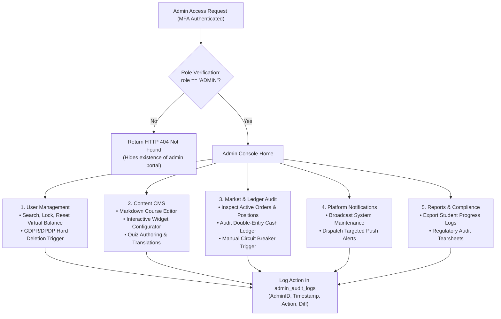
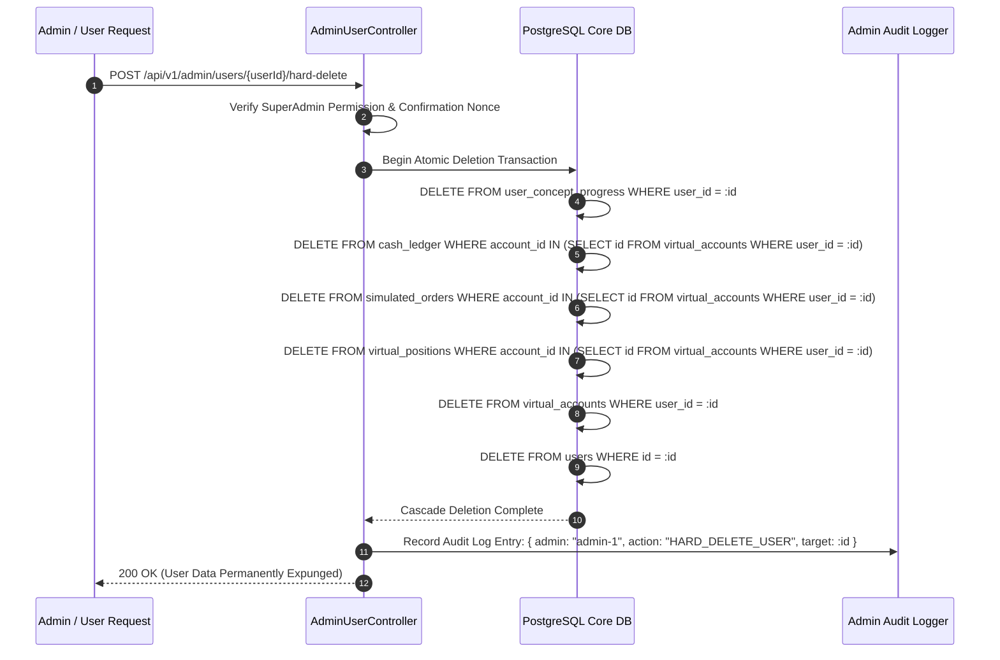

# Admin Panel Technical Specification
## Project: MarketMaster Academy
**Access Control**: Role-Based (`role === 'ADMIN'`), Multi-Factor Authentication (MFA) Enforced  
**Version**: 1.1.0  

---

### 1. Administrative Workflow & RBAC State Machine

---

### 2. User Data Erasure (Right to be Forgotten) Sequence Diagram

