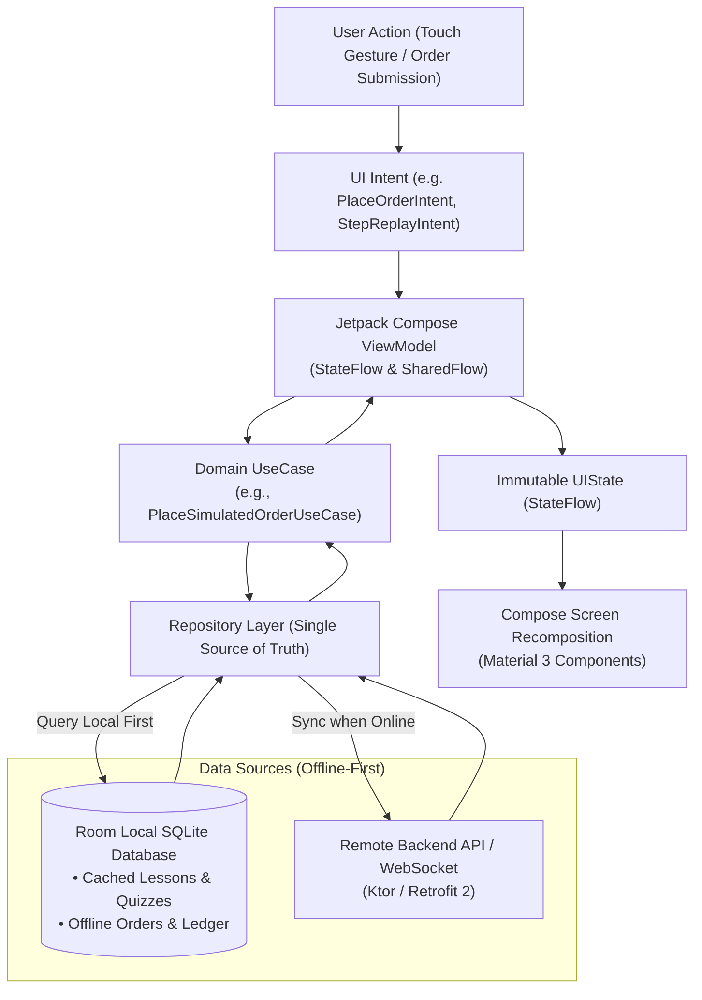
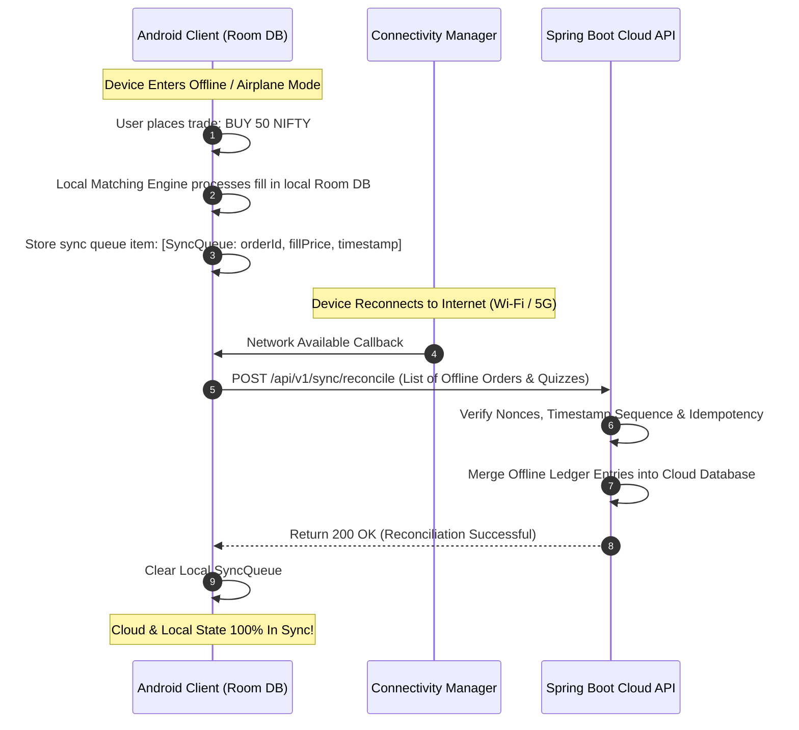

# Android Architecture Specification
## Project: MarketMaster Academy Native Android Client
**Platform**: Android 8.0+ (API 26 to API 35+)  
**Language & Framework**: Kotlin 2.0+, Jetpack Compose, Coroutines & Flow, Room ORM  
**Version**: 1.1.0  

---

### 1. MVI / Clean Architecture Unidirectional Data Flow

---

### 2. Offline-First Reconnection & Synchronization Sequence

The Android client allows users to study courses and execute simulated paper trades even with zero internet connectivity. When internet access resumes, local state reconciles with the backend.

