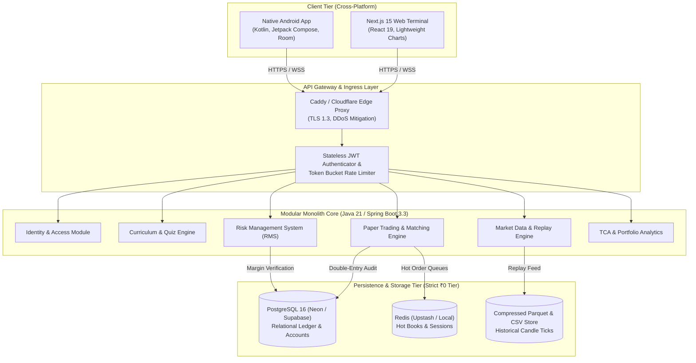
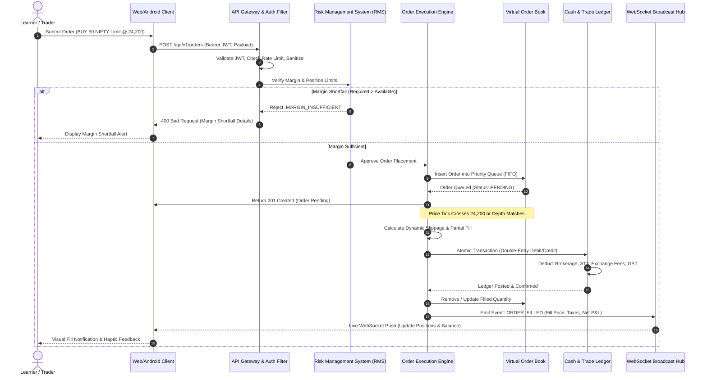
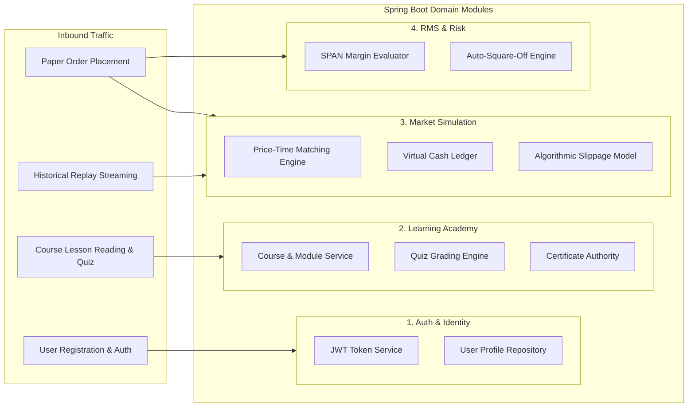

# System Architecture Specification & Topology
## Project: MarketMaster Academy
**Author**: Enterprise Architecture Board  
**Version**: 1.1.0  
**Status**: Active Production Standard  

---

### 1. Architectural Philosophy & Core Axioms

MarketMaster Academy is architected as an **Event-Driven Modular Monolith** with client-side compute offloading, designed to deliver institutional-grade financial simulation, sub-millisecond local execution feedback, and zero ongoing cloud operational cost.

---

### 2. Comprehensive Component Interaction Flow (Sequence Diagram)

The following sequence diagram illustrates the complete end-to-end lifecycle of an order: from client placement, through authentication, risk assessment, virtual order book matching, slippage application, to immutable double-entry ledger posting and WebSocket broadcast.

---

### 3. Subsystem Domain Deconstruction

---

### 4. Data Flow Invariants & Security Boundaries
1. **Zero Secret Leakage**: API keys and database credentials reside exclusively in server-side environment variables. Client bundles (Web JS and Android APK) contain zero credentials.
2. **Replay Integrity**: The client is delivered market data strictly bar-by-bar during replay mode. The entire historical dataset is never sent in advance, preventing clients from inspecting upcoming candles via network sniffers or developer tools.
3. **Double-Entry Ledger Consistency**: Cash balances cannot be directly incremented or decremented; they are mathematical summations of immutable credit and debit rows.
