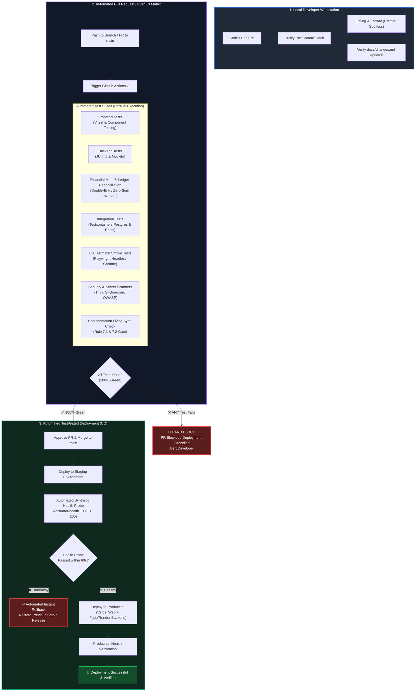

# Automated Testing, CI/CD & Gated Deployment Specification
## Project: MarketMaster Academy
**Standard**: ISO/IEC 25010 & IEEE 829 Test Gating Framework  
**Core Invariant**: 100% Automated Testing Precedes Every Single Deployment  
**Budget Constraint**: ₹0 Infrastructure Spend (GitHub Actions Free Tier + Free Cloud Platforms)  

---

### 1. Executive Summary & Philosophy

In financial simulation platforms, algorithmic errors, rounding discrepancies, or unverified deployments lead to broken ledgers, corrupted order states, and user distrust. MarketMaster Academy enforces a strict **"Test-First, Automate Everything, Fail-Closed"** policy. Under [Rule 8.1 through 8.4](rules.md), **no change is ever pushed to production without passing comprehensive, automated multi-layer test suites**.



---

### 2. Multi-Layer Automated Testing Hierarchy

Every code modification must pass 7 distinct automated test gates before deployment is unlocked:

| Gate | Target Layer | Framework / Tool | Execution Trigger | Gate Criteria |
| :--- | :--- | :--- | :--- | :--- |
| **Gate 1** | Code Style & Types | ESLint, TypeScript `tsc`, Spotless | Pre-commit & CI | Zero lint warnings; zero type errors |
| **Gate 2** | Frontend Units | Vitest, React Testing Library | CI on PR / Push | 100% pass; >80% statement coverage |
| **Gate 3** | Backend Units | JUnit 5, Mockito, AssertJ | CI on PR / Push | 100% pass; >85% service coverage |
| **Gate 4** | Financial Ledger Math | Custom JUnit Suite (`ReconciliationTest`) | CI on PR / Push | $\sum \text{Debits} == \sum \text{Credits}$; Zero rounding drift |
| **Gate 5** | Database & Cache | Testcontainers (Postgres 16 + Redis 7) | CI on PR / Push | All migrations apply; zero FK orphans |
| **Gate 6** | E2E Trading Flows | Playwright (Headless Web) | CI on PR / Push | Login, chart load, buy/sell cycle, P&L update |
| **Gate 7** | Living Doc Audit | Custom Shell / Python Validator | Pre-commit & CI | `docs/changes.md` updated with timestamp |

---

### 3. Financial Math & Double-Entry Ledger Reconciliation Tests

Because MarketMaster simulates institutional order books and tax deductions (STT, GST, Stamp Duty), floating-point rounding errors are catastrophic. Gate 4 runs dedicated invariant tests:

```java
@Test
void verifyDoubleEntryLedgerZeroSumInvariant() {
    // 1. Simulate 10,000 randomized trades across multiple assets
    OrderSimulationRunner.executeBatch(10_000);

    // 2. Query total debits and credits across the entire virtual ecosystem
    BigDecimal totalDebits = ledgerRepository.sumAllDebits();
    BigDecimal totalCredits = ledgerRepository.sumAllCredits();

    // 3. Mathematical Invariant: Total Debits MUST equal Total Credits exactly
    assertThat(totalDebits)
        .isEqualByComparingTo(totalCredits);

    // 4. Invariant: User Balance + Reserved Margin == Ledger Net Worth
    userRepository.findAll().forEach(user -> {
        BigDecimal cash = user.getCashBalance();
        BigDecimal lockedMargin = user.getReservedMargin();
        BigDecimal computedLedgerTotal = ledgerRepository.computeNetCashForUser(user.getId());
        assertThat(cash.add(lockedMargin))
            .isEqualByComparingTo(computedLedgerTotal);
    });
}
```

---

### 4. Automated Pre-Commit Gating (Local Machine)

Pre-commit hooks stop defective code before it ever reaches GitHub. Configured via **Husky** and **lint-staged**:

```json
// .husky/pre-commit
{
  "*.{ts,tsx,js,jsx}": [
    "eslint --fix",
    "prettier --write"
  ],
  "*.java": [
    "mvn spotless:apply"
  ]
}
```

#### Automated Living Documentation Hook:
A lightweight git hook checks if `.java`, `.ts`, `.tsx`, or `.sql` files are in `git status --cached`. If code is staged but neither `docs/changes.md` nor `docs/decision.md` has been staged, the commit is aborted:

```bash
#!/bin/sh
# .husky/check-doc-sync.sh
CODE_CHANGED=$(git diff --cached --name-only | grep -E '(frontend/|backend/|android/|docker/)')
DOCS_CHANGED=$(git diff --cached --name-only | grep -E 'docs/(changes|decision)\.md')

if [ -n "$CODE_CHANGED" ] && [ -z "$DOCS_CHANGED" ]; then
  echo "🚨 [RULE 7.2 VIOLATION]: Code changes detected without synchronized documentation!"
  echo "   You must update docs/changes.md with your changes before committing."
  exit 1
fi
```

---

### 5. Automated CI GitHub Actions Pipeline Specification

File: `.github/workflows/ci.yml`

```yaml
name: MarketMaster Continuous Integration & Quality Gate

on:
  push:
    branches: [ main, develop ]
  pull_request:
    branches: [ main ]

jobs:
  validate-docs:
    name: Living Documentation Integrity Check (Rule 7.1-7.3)
    runs-on: ubuntu-latest
    steps:
      - uses: actions/checkout@v4
        with:
          fetch-depth: 2
      - name: Verify docs/changes.md modified on code change
        run: |
          CHANGED_CODE=$(git diff --name-only HEAD~1 HEAD | grep -E '^(frontend|backend|android)/' || true)
          CHANGED_DOCS=$(git diff --name-only HEAD~1 HEAD | grep -E '^docs/(changes|decision)\.md' || true)
          if [ -n "$CHANGED_CODE" ] && [ -z "$CHANGED_DOCS" ]; then
            echo "❌ Error: Code was modified but docs/changes.md was not updated."
            exit 1
          fi
          echo "✅ Documentation sync verified."

  test-backend:
    name: Backend Unit & Integration Tests (Java 21 / Spring Boot)
    runs-on: ubuntu-latest
    steps:
      - uses: actions/checkout@v4
      - name: Set up JDK 21
        uses: actions/setup-java@v4
        with:
          java-version: '21'
          distribution: 'temurin'
          cache: maven
      - name: Run Spotless Code Format Check
        run: mvn -B spotless:check
      - name: Run Tests with Testcontainers (Postgres & Redis)
        run: mvn -B test verify
      - name: Upload Test Results
        if: always()
        uses: actions/upload-artifact@v4
        with:
          name: backend-test-reports
          path: backend/target/surefire-reports/

  test-frontend:
    name: Frontend Unit & Component Tests (Next.js 15 / React 19)
    runs-on: ubuntu-latest
    steps:
      - uses: actions/checkout@v4
      - name: Set up Node.js 20
        uses: actions/setup-node@v4
        with:
          node-version: 20
          cache: 'npm'
          cache-dependency-path: frontend/package-lock.json
      - name: Install Dependencies
        run: cd frontend && npm ci
      - name: TypeScript & Lint Check
        run: cd frontend && npm run lint && npx tsc --noEmit
      - name: Run Vitest Suite
        run: cd frontend && npm run test -- --run

  test-e2e:
    name: End-to-End Terminal Smoke Tests (Playwright)
    needs: [test-backend, test-frontend]
    runs-on: ubuntu-latest
    steps:
      - uses: actions/checkout@v4
      - name: Set up Node.js 20
        uses: actions/setup-node@v4
        with:
          node-version: 20
      - name: Install Playwright Browsers
        run: cd frontend && npm ci && npx playwright install --with-deps chromium
      - name: Execute E2E Smoke Tests
        run: cd frontend && npx playwright test
```

---

### 6. Automated Test-Gated Deployment (CD) & Health Rollback

File: `.github/workflows/deploy.yml`

```yaml
name: Test-Gated Deployment Pipeline

on:
  push:
    branches: [ main ]

jobs:
  gate-keeper:
    name: Verify All Tests Passed
    uses: ./.github/workflows/ci.yml

  deploy-staging:
    name: Deploy to Staging & Run Synthetic Probes
    needs: [ gate-keeper ]
    runs-on: ubuntu-latest
    steps:
      - uses: actions/checkout@v4
      - name: Deploy Backend to Staging Container
        run: |
          echo "Deploying artifact to staging cluster..."
      - name: Deploy Frontend to Staging Edge
        run: |
          echo "Deploying Next.js edge build to staging preview..."
      - name: Synthetic Health Probe Check
        run: |
          echo "Probing staging endpoint: https://staging.marketmaster.internal/actuator/health"
          STATUS=$(curl -s -o /dev/null -w "%{http_code}" https://staging.marketmaster.internal/actuator/health || echo "500")
          if [ "$STATUS" -ne 200 ]; then
            echo "🚨 Staging probe failed with HTTP $STATUS! Aborting deployment."
            exit 1
          fi
          echo "✅ Staging synthetic probe passed."

  deploy-production:
    name: Automated Production Deployment & Instant Health Rollback
    needs: [ deploy-staging ]
    runs-on: ubuntu-latest
    steps:
      - name: Trigger Production Deployment
        run: |
          echo "Triggering zero-downtime production cutover..."
      - name: Automated Post-Deploy Health Check (60-second window)
        run: |
          for i in {1..6}; do
            HTTP_CODE=$(curl -s -o /dev/null -w "%{http_code}" https://marketmaster.vercel.app/api/health || echo "500")
            if [ "$HTTP_CODE" -eq 200 ]; then
              echo "✅ Production health probe successful (attempt $i)."
              exit 0
            fi
            echo "Waiting 10s for service warm-up (attempt $i)..."
            sleep 10
          done
          echo "🚨 Post-deployment health verification failed! Triggering automatic rollback."
          # Automated Rollback Trigger
          curl -X POST https://api.render.com/v1/services/${SERVICE_ID}/rollback -H "Authorization: Bearer ${{ secrets.RENDER_API_KEY }}"
          exit 1
```

---

### 7. Summary of Invariant Guarantees
1. **Never Deploy Untested Code**: If any test fails, CI exits with a non-zero code and CD jobs are canceled.
2. **Deterministic Ledger**: Accounting reconciliation tests verify that no virtual paisa or rupee is created or destroyed.
3. **Automated Documentation Enforcement**: Developers cannot commit code changes without logging them in `docs/changes.md`.
4. **Self-Healing Deployments**: If a deployed container fails startup or health checks, automatic rollback executes within 60 seconds without requiring human manual intervention.

