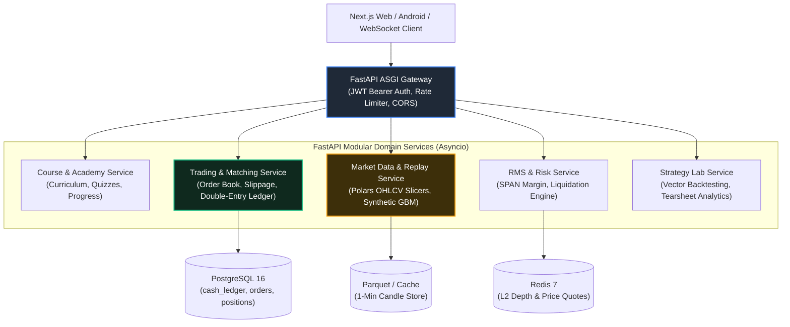

# Backend Architecture Specification: Lightweight Python Quant Stack
## Project: MarketMaster Academy
**Runtime & Framework**: Python 3.12+ / FastAPI / Uvicorn (ASGI)  
**Architecture Pattern**: Async Modular Architecture with High-Performance Quant Libraries  
**Version**: 2.0.0  

---

### 1. Technology Choices & High-Concurrency Principles

To deliver maximum agility, rapid development velocity, lightweight cloud footprint, and native financial mathematical capabilities, MarketMaster Academy standardizes on an ultra-lightweight, high-performance Python asynchronous stack:

* **FastAPI + Uvicorn**: High-performance, asynchronous ASGI web framework. Native asynchronous request handling, sub-millisecond route dispatching, automatic OpenAPI 3.1 interactive docs, and seamless WebSocket streaming for live order-book tickers.
* **Polars & Pandas**: Lightning-fast columnar DataFrame processing. Polars uses multi-threaded Rust internals for blazing-fast OHLCV historical candle slicing, rolling indicator computation, and backtesting aggregations with 1/10th the memory footprint of traditional JVM monoliths.
* **NumPy & SciPy**: Native vectorized math engine powering Black-Scholes option pricing, Greeks ($\Delta, \Gamma, \Theta, \mathcal{V}, \rho$), Sortino/Sharpe ratios, maximum drawdown calculations, and Glicko-2 rating updates.
* **SQLAlchemy 2.0 (Asyncio) & Alembic**: Non-blocking asynchronous ORM connecting to PostgreSQL 16 with asyncpg drivers. Automated, declarative schema migrations via Alembic.
* **Pydantic v2**: High-speed Rust-compiled schema validation, enforcing zero-frontend-trust data verification on every order tick, lot size, and margin calculation.
* **Redis-Py (Asyncio)**: Low-latency caching for real-time order depth ladders, active session tokens, and daily challenge leaderboards.

---

### 2. Service Modules & Async Architecture

---

### 3. Background Async Tasks & Cron Schedulers

1. **Daily Challenge Rotator**: Fires daily at 00:00:00 UTC via async background worker to select 3 new randomized historical scenarios, calculate previous day's rankings, and reset leaderboards.
2. **RMS Real-time Margin Evaluator**: Runs on async event loop every 100ms during active replay sessions to verify position margins against liquidation boundaries.
3. **Double-Entry Reconciliation Worker**: Runs every 10 minutes to verify the zero-sum ledger invariant ($\sum \text{Debits} == \sum \text{Credits}$) across all accounts.
