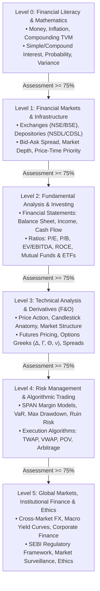

# Master Curriculum Architecture (Levels 0 through 5)
## Project: MarketMaster Academy
**Pedagogical Alignment**: SEBI Investor Education, NSE NCFM/NISM, CME Group Institute, IBKR Traders' Academy, Zerodha Varsity  
**Coverage**: 6 Levels, 24 Domains, 200+ Granular Micro-Concepts  
**Version**: 1.1.0  

---

### 1. The 6-Level Pedagogical Mastery Progression Flowchart

---

### 2. Standardized 10-Point Concept Learning Cycle

Every single concept (e.g. *Bid-Ask Spread*, *Delta*, *TWAP*) follows an identical, rigorous 10-step pedagogical cycle:

```mermaid
flowchart LR
    Step1["1. Concept Intro (ELI5)"] --> Step2["2. Formal Definition"]
    Step2 --> Step3["3. Mathematical Derivation"]
    Step3 --> Step4["4. Visual Diagram / Chart"]
    Step4 --> Step5["5. Worked Rupee Example"]
    Step5 --> Step6["6. Retail Traps & Risks"]
    Step6 --> Step7["7. Historical Case Study"]
    Step7 --> Step8["8. Interactive Calculator"]
    Step8 --> Step9["9. Simulator Practice Task"]
    Step9 --> Step10["10. 4-Question Assessment"]
```

---

### 3. Detailed Syllabus Outline & Concept Mapping

#### Level 0: Financial Literacy & Quantitative Prerequisites
* **Domain 0.1: Nature of Money & Value**: Barter to Central Bank fiat, purchasing power, real vs nominal returns, time value of money.
* **Domain 0.2: Personal Finance & Goals**: Emergency funds, debt amortization schedules, risk capacity vs risk tolerance, compounding frequency.
* **Domain 0.3: Quantitative Foundations**: Basis points (bps), geometric vs arithmetic returns, CAGR formula derivation, probability density, normal distribution, standard deviation ($\sigma$).

#### Level 1: Market Infrastructure & Microstructure
* **Domain 1.1: Market Institutions**: SEBI regulatory powers, NSE/BSE exchange engines, NSDL/CDSL depositories, T+1 settlement cycles, SCORES grievance platform.
* **Domain 1.2: Market Microstructure**: Quoted prices (LTP, Best Bid, Best Ask), Spread calculation ($S = P_{\text{ask}} - P_{\text{bid}}$), 5x5 Level 2 order book depth, Order Book Imbalance (OBI).
* **Domain 1.3: Order Types & Execution Rules**: Market, Limit, Stop-Loss Market (SL-M), Stop-Loss Limit (SL-L), Bracket Orders (BO), Cover Orders (CO), dynamic slippage, gap openings.

#### Level 2: Financial Statements, Valuation & Investing
* **Domain 2.1: Accounting Foundations**: Accounting equation, Balance Sheet assets/liabilities, Income Statement revenue to PAT, Cash Flow operating/investing/financing.
* **Domain 2.2: Equity Valuation**: Enterprise Value (EV), P/E ratio, P/B ratio, EV/EBITDA, ROCE, ROE, Discounted Cash Flow (DCF) concepts, margin of safety.
* **Domain 2.3: Funds & Fixed Income**: NAV, tracking error, expense ratios, SIP/STP/SWP mathematics, G-Secs, T-Bills, corporate debentures, Yield to Maturity (YTM), Macaulay Duration.

#### Level 3: Technical Analysis & Derivatives
* **Domain 3.1: Technical Analysis**: Candlestick wick absorption, support/resistance flips, volume confirmation, VWAP bands, RSI, MACD, Bollinger Bands, ATR.
* **Domain 3.2: Futures Contracts**: Contract specs, lot sizes, expiries, Cost-of-Carry pricing ($F = S e^{rT}$), basis, contango, backwardation, daily MTM settlement.
* **Domain 3.3: Options Mechanics & Greeks**: Calls/Puts, moneyness (ITM, ATM, OTM), Black-Scholes pricing, Delta ($\Delta$), Gamma ($\Gamma$), Theta ($\Theta$), Vega ($\nu$), Rho ($\rho$), multi-leg spreads (Bull Call, Iron Condor, Butterflies).

#### Level 4: Risk Management & Algorithmic Execution
* **Domain 4.1: RMS & Portfolio Risk**: Position sizing formulas, Value at Risk (VaR), Maximum Drawdown, Risk of Ruin, SPAN margin scenario testing, automated liquidation.
* **Domain 4.2: Algorithmic Execution**: TWAP, VWAP, POV, POV Price Bands, Iceberg Orders, Smart Incognito, Cash-Futures Arbitrage.
* **Domain 4.3: Strategy Backtesting**: Transaction Cost Analysis (TCA), survivorship bias, data leakage, walk-forward out-of-sample testing.

#### Level 5: Global Markets, Institutional Finance & Ethics
* **Domain 5.1: Global Macro**: Global interdependencies (NYSE, Nasdaq, LSE, SGX), currency pairs (USDINR), central bank interest rate differentials.
* **Domain 5.2: Professional Ethics**: SEBI retail algo regulations, insider trading prevention, market manipulation detection, behavioral trading psychology.
