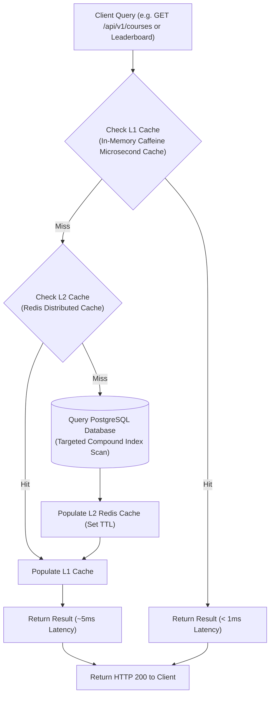
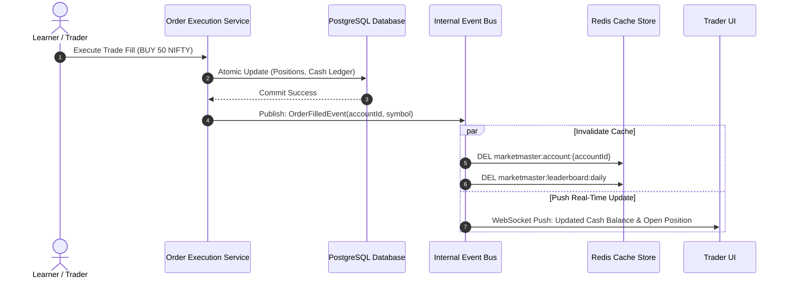

# Database Scaling & Caching Strategy
## Project: MarketMaster Academy
**RDBMS**: PostgreSQL 16+ (Neon Serverless / Supabase Free Tier)  
**In-Memory Cache**: Redis (Upstash Serverless Free Tier / Local Redis)  
**Version**: 1.1.0  

---

### 1. Multi-Tier Cache-Aside Architecture

---

### 2. Cache Invalidation Event Lifecycle (Sequence Diagram)

---

### 3. Scaling Progression Roadmap (0 to 100,000+ Users)

```mermaid
flowchart LR
    subgraph Tier1["Tier 1: ₹0 Free Tier (0 to 20k Users)"]
        SingleDB["Single PostgreSQL Serverless DB"]
        HikariPool["HikariCP Pool (Max 10 Conns)"]
        ClientWasm["Pyodide WASM Compute Offload"]
    end

    subgraph Tier2["Tier 2: Intermediate (20k to 100k Users)"]
        TimescalePart["TimescaleDB Hypertables (Candle Partitioning)"]
        RedisCluster["Dedicated Redis Cluster"]
        ReadCache["Read-Heavy Edge Caching (99% Hit Ratio)"]
    end

    subgraph Tier3["Tier 3: Enterprise Scale (100k+ Users)"]
        ReadReplicas["PostgreSQL Read Replicas"]
        KafkaStreaming["Kafka Event Streaming Pipeline"]
        GlobalEdge["Global Multi-Region Read Replicas"]
    end

    Tier1 --> Tier2 --> Tier3
```

