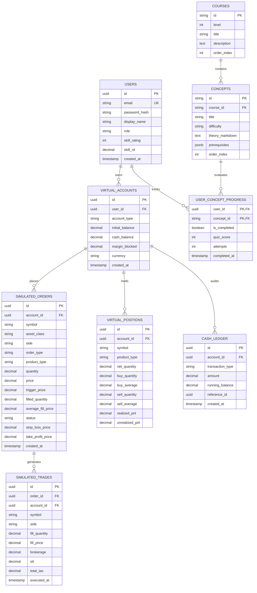

# Relational Database Schema Specification
## Project: MarketMaster Academy
**RDBMS**: PostgreSQL 16+ (Compatible with TimescaleDB & SQLite)  
**Schema Version**: 1.1.0  

---

### 1. Entity-Relationship Diagram (`erDiagram`)



---

### 2. Complete SQL DDL Specification & Constraints

```sql
-- PostgreSQL 16 Enterprise DDL

CREATE EXTENSION IF NOT EXISTS "uuid-ossp";

-- 1. USERS TABLE
CREATE TABLE users (
    id UUID PRIMARY KEY DEFAULT uuid_generate_v4(),
    email VARCHAR(255) UNIQUE NOT NULL,
    password_hash VARCHAR(255) NOT NULL,
    display_name VARCHAR(100) NOT NULL,
    role VARCHAR(50) DEFAULT 'USER' CHECK (role IN ('USER', 'ADMIN', 'MODERATOR')),
    skill_rating INT DEFAULT 1200 CHECK (skill_rating >= 0),
    skill_rd DECIMAL(6,2) DEFAULT 350.00,
    created_at TIMESTAMP WITH TIME ZONE DEFAULT CURRENT_TIMESTAMP,
    updated_at TIMESTAMP WITH TIME ZONE DEFAULT CURRENT_TIMESTAMP
);

-- 2. ACCOUNTS TABLE
CREATE TABLE virtual_accounts (
    id UUID PRIMARY KEY DEFAULT uuid_generate_v4(),
    user_id UUID NOT NULL REFERENCES users(id) ON DELETE CASCADE,
    account_type VARCHAR(50) DEFAULT 'STANDARD' CHECK (account_type IN ('STANDARD', 'RATED_GYM', 'DAILY_CHALLENGE')),
    initial_balance DECIMAL(15,2) DEFAULT 1000000.00,
    cash_balance DECIMAL(15,2) DEFAULT 1000000.00,
    margin_blocked DECIMAL(15,2) DEFAULT 0.00 CHECK (margin_blocked >= 0.00),
    currency VARCHAR(10) DEFAULT 'INR',
    created_at TIMESTAMP WITH TIME ZONE DEFAULT CURRENT_TIMESTAMP
);

-- 3. CASH LEDGER (IMMUTABLE AUDIT TRAIL)
CREATE TABLE cash_ledger (
    id UUID PRIMARY KEY DEFAULT uuid_generate_v4(),
    account_id UUID NOT NULL REFERENCES virtual_accounts(id) ON DELETE CASCADE,
    transaction_type VARCHAR(50) NOT NULL CHECK (transaction_type IN ('DEPOSIT', 'TRADE_BUY', 'TRADE_SELL', 'BROKERAGE', 'STT', 'EXCHANGE_FEE', 'GST', 'STAMP_DUTY', 'MTM_SETTLEMENT')),
    amount DECIMAL(15,2) NOT NULL,
    running_balance DECIMAL(15,2) NOT NULL,
    reference_id UUID,
    created_at TIMESTAMP WITH TIME ZONE DEFAULT CURRENT_TIMESTAMP
);

-- 4. SIMULATED ORDERS
CREATE TABLE simulated_orders (
    id UUID PRIMARY KEY DEFAULT uuid_generate_v4(),
    account_id UUID NOT NULL REFERENCES virtual_accounts(id) ON DELETE CASCADE,
    symbol VARCHAR(50) NOT NULL,
    asset_class VARCHAR(50) NOT NULL CHECK (asset_class IN ('EQUITY', 'FUTURES', 'OPTIONS', 'COMMODITY', 'FOREX')),
    side VARCHAR(10) NOT NULL CHECK (side IN ('BUY', 'SELL')),
    order_type VARCHAR(20) NOT NULL CHECK (order_type IN ('MARKET', 'LIMIT', 'SL_MARKET', 'SL_LIMIT', 'BRACKET')),
    product_type VARCHAR(20) NOT NULL CHECK (product_type IN ('MIS', 'CNC', 'NRML')),
    quantity DECIMAL(15,4) NOT NULL CHECK (quantity > 0),
    price DECIMAL(15,4),
    trigger_price DECIMAL(15,4),
    filled_quantity DECIMAL(15,4) DEFAULT 0.00,
    average_fill_price DECIMAL(15,4) DEFAULT 0.00,
    status VARCHAR(30) DEFAULT 'PENDING' CHECK (status IN ('PENDING', 'PARTIALLY_FILLED', 'FILLED', 'CANCELLED', 'REJECTED')),
    stop_loss_price DECIMAL(15,4),
    take_profit_price DECIMAL(15,4),
    rejection_reason TEXT,
    created_at TIMESTAMP WITH TIME ZONE DEFAULT CURRENT_TIMESTAMP,
    updated_at TIMESTAMP WITH TIME ZONE DEFAULT CURRENT_TIMESTAMP
);

-- 5. SIMULATED TRADES (FILLS)
CREATE TABLE simulated_trades (
    id UUID PRIMARY KEY DEFAULT uuid_generate_v4(),
    order_id UUID NOT NULL REFERENCES simulated_orders(id) ON DELETE CASCADE,
    account_id UUID NOT NULL REFERENCES virtual_accounts(id) ON DELETE CASCADE,
    symbol VARCHAR(50) NOT NULL,
    side VARCHAR(10) NOT NULL,
    fill_quantity DECIMAL(15,4) NOT NULL,
    fill_price DECIMAL(15,4) NOT NULL,
    brokerage DECIMAL(10,2) DEFAULT 0.00,
    stt DECIMAL(10,2) DEFAULT 0.00,
    total_tax DECIMAL(10,2) DEFAULT 0.00,
    executed_at TIMESTAMP WITH TIME ZONE DEFAULT CURRENT_TIMESTAMP
);

-- 6. POSITIONS
CREATE TABLE virtual_positions (
    id UUID PRIMARY KEY DEFAULT uuid_generate_v4(),
    account_id UUID NOT NULL REFERENCES virtual_accounts(id) ON DELETE CASCADE,
    symbol VARCHAR(50) NOT NULL,
    product_type VARCHAR(20) NOT NULL,
    net_quantity DECIMAL(15,4) NOT NULL,
    buy_quantity DECIMAL(15,4) DEFAULT 0.00,
    buy_average DECIMAL(15,4) DEFAULT 0.00,
    sell_quantity DECIMAL(15,4) DEFAULT 0.00,
    sell_average DECIMAL(15,4) DEFAULT 0.00,
    realized_pnl DECIMAL(15,2) DEFAULT 0.00,
    unrealized_pnl DECIMAL(15,2) DEFAULT 0.00,
    created_at TIMESTAMP WITH TIME ZONE DEFAULT CURRENT_TIMESTAMP,
    updated_at TIMESTAMP WITH TIME ZONE DEFAULT CURRENT_TIMESTAMP,
    UNIQUE (account_id, symbol, product_type)
);

-- 7. CANDLE REPOSITORY
CREATE TABLE historical_candles (
    symbol VARCHAR(50) NOT NULL,
    timeframe VARCHAR(10) NOT NULL,
    bucket_timestamp TIMESTAMP WITH TIME ZONE NOT NULL,
    open_price DECIMAL(15,4) NOT NULL,
    high_price DECIMAL(15,4) NOT NULL,
    low_price DECIMAL(15,4) NOT NULL,
    close_price DECIMAL(15,4) NOT NULL,
    volume DECIMAL(18,2) NOT NULL,
    PRIMARY KEY (symbol, timeframe, bucket_timestamp)
);
```

---

### 3. Targeted Compound Performance Indexes
```sql
CREATE INDEX idx_orders_lookup ON simulated_orders(account_id, status, created_at DESC);
CREATE INDEX idx_ledger_audit ON cash_ledger(account_id, created_at DESC);
CREATE INDEX idx_positions_lookup ON virtual_positions(account_id, net_quantity);
CREATE INDEX idx_candles_slice ON historical_candles(symbol, timeframe, bucket_timestamp DESC);
```
