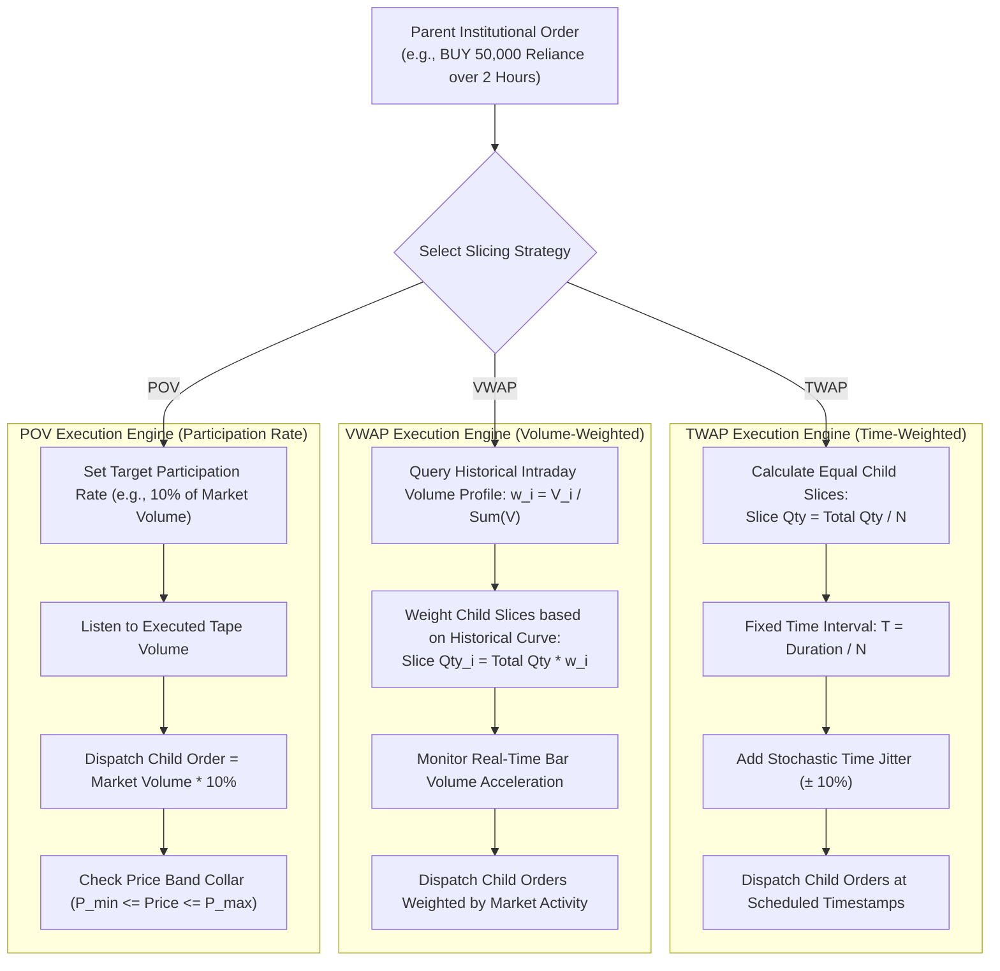
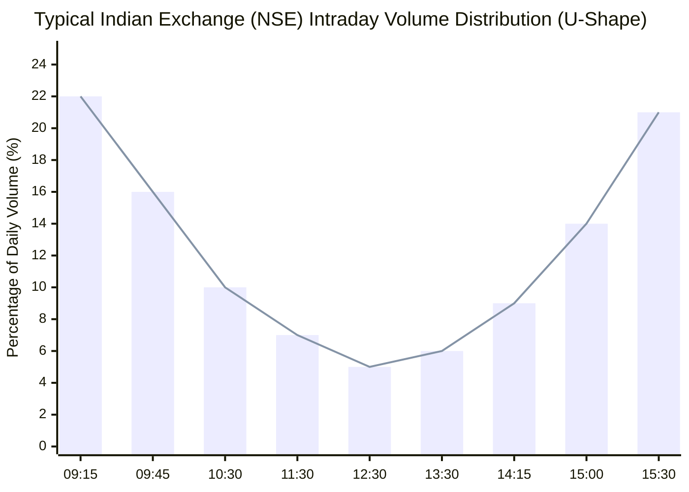
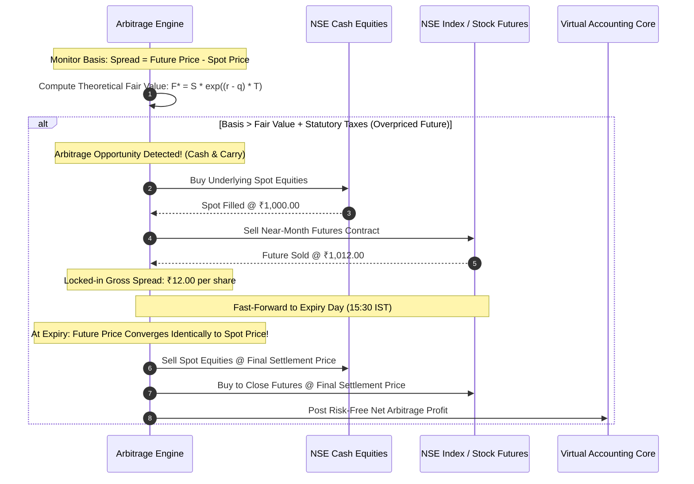

# Execution Algorithms Specification & Institutional Slicers
## Project: MarketMaster Academy
**Component**: Algorithmic Order Slicing, Strategy Lab & Execution Models  
**Version**: 1.1.0  

---

### 1. TWAP vs VWAP Slicing Comparative Architecture



---

### 2. Intraday Volume Profile Distribution (VWAP Curve)

Real exchange volume follows a distinct "U-shaped" curve (high volume in the opening and closing 30 minutes, quiet midday lunch period):



---

### 3. Iceberg Order Execution State Machine

```mermaid
stateDiagram-v2
    [*] --> INITIALIZED: Total Quantity = 10,000, Display Size = 500
    
    INITIALIZED --> ACTIVE_TIER: Expose 500 Shares on Order Book
    
    ACTIVE_TIER --> WAITING_FILL: Order Resting in Matching Queue
    
    WAITING_FILL --> PARTIAL_FILL: Inbound Trades Hit Top of Book
    PARTIAL_FILL --> WAITING_FILL: Active Display Shares Remaining > 0
    
    WAITING_FILL --> TRANCHE_FILLED: Active 500 Shares 100% Filled
    
    TRANCHE_FILLED --> CHECK_REMAINING{"Remaining Parent Qty > 0?"}
    CHECK_REMAINING -->|Yes| ACTIVE_TIER: Reload Next 500 Shares to Book
    CHECK_REMAINING -->|No| COMPLETE: Full 10,000 Shares Filled
    
    COMPLETE --> [*]
```

---

### 4. Cash-Futures Arbitrage Execution Mechanics


