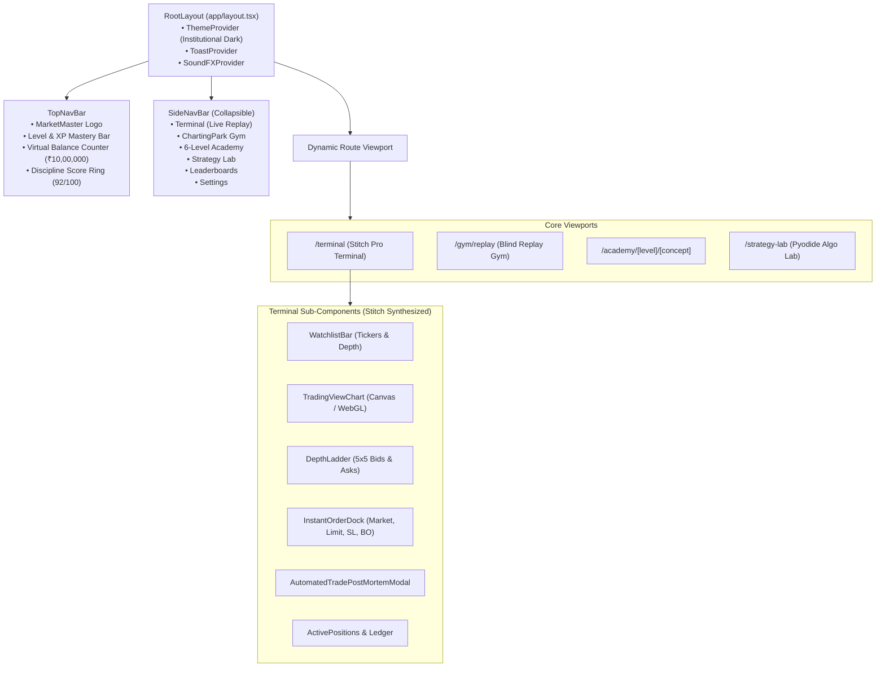
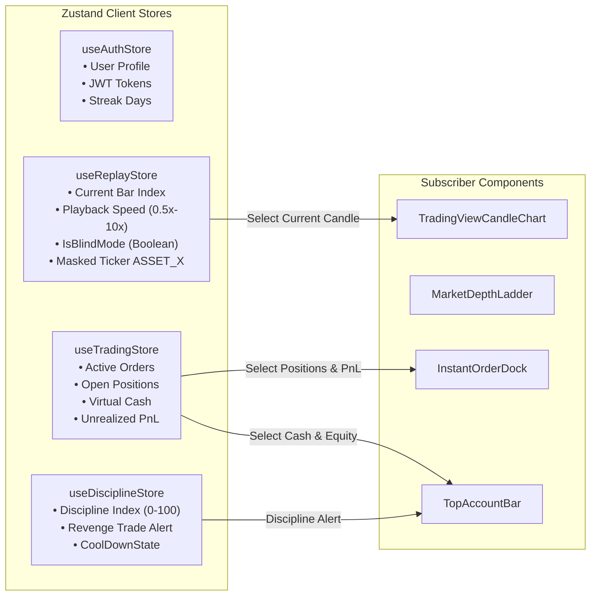

# Frontend Architecture Specification: Stitch-Powered Responsive UI
## Project: MarketMaster Academy
**Framework**: Next.js 15 (App Router), React 19, TypeScript 5.5+, Tailwind CSS v4  
**UI Engine & Prototyping**: Stitch UI AI Platform, Framer Motion, Lucide Icons, TradingView Lightweight Charts  
**Aesthetic Standard**: Institutional Dark Terminal (`#080C14`), Luminous Accent Accents, Responsive Multi-Breakpoint  
**Version**: 2.0.0  

---

### 1. Stitch UI Integration & Design Philosophy

MarketMaster Academy leverages **Stitch UI** to design, prototype, and synthesize production-grade interactive screens and design systems:

* **Institutional Terminal Dark Theme**:
  * Deep background: `slate-950` (`#080C14`) with glassmorphism card containers (`rgba(15, 23, 42, 0.75)` with subtle `border-slate-800/80`).
  * Financial metrics: Emerald green (`#10B981`) for profits and bids; bright rose (`#F43F5E`) for losses and asks; cyan (`#06B6D4`) for order markers and execution cursors.
* **Fluid Responsiveness Across All Form Factors**:
  * **Desktop Terminal (>= 1280px)**: Multi-pane Bloomberg/TradingView workstation layout (Watchlist, 1-min Chart, Level-2 Depth Ladder, Fast Order Dock, and Positions Ledger visible simultaneously).
  * **Tablet / Compact (768px - 1279px)**: Dual-pane collapsible drawer layout with tabbed bottom dock.
  * **Mobile Terminal (< 768px)**: Bottom-sheet execution drawer, quick-swipe timeframe toggles, and thumb-friendly One-Tap Buy/Sell buttons.
* **Micro-Interactions & Gamified Rewards**:
  * **Framer Motion**: Smooth entry/exit animations for modals, price flash animations when bids/asks tick, and animated progress rings for lesson completion.
  * **Discipline Visualizer**: Dynamic glowing ring showing real-time trader discipline score.
  * **Sound & Confetti**: Subtle audio feedback on order execution; canvas-confetti bursts upon mastering a curriculum level or completing a Daily Replay Challenge.

---

### 2. Component Hierarchy & Layout Tree

---

### 3. Client-Side State Management (Zustand Flowchart)

