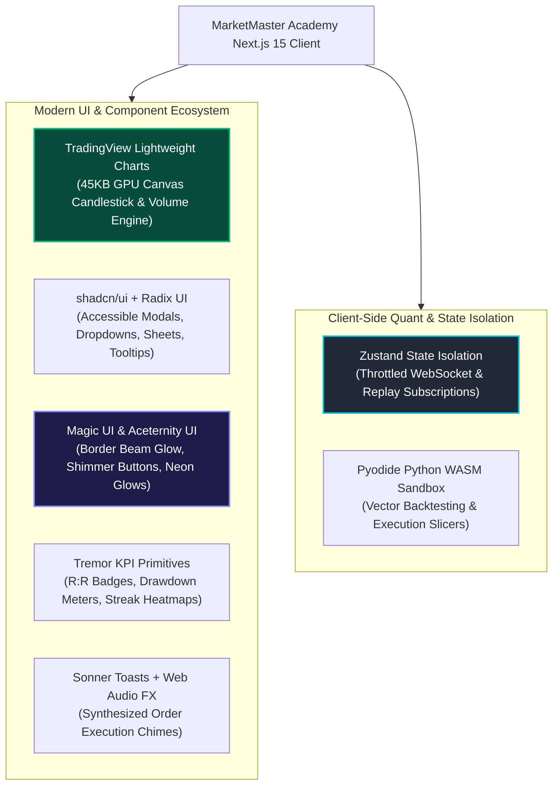

# Modern Frontend Architecture Specification (2025/2026 Edition)
## Project: MarketMaster Academy
**Core Framework**: Next.js 15 (App Router), React 19, TypeScript 5.5+, Tailwind CSS v4  
**Modern UI Ecosystem**:
* **Charting Engine**: TradingView Lightweight Charts (Canvas/WebGL GPU-accelerated, ~45KB)
* **Design & Primitive System**: shadcn/ui + Radix UI accessible primitives
* **Visual Polish & Micro-Interactions**: Magic UI (Border Beams, Retro Grid, Neon Shimmer) & Aceternity UI
* **Financial Analytics & KPI Telemetry**: Tremor-style metric cards, delta trackers, and performance heatmaps
* **Notifications & Feedback**: Sonner stackable toasts + Browser Web Audio API sound synthesis + Canvas Confetti
* **State Management**: Zustand (isolated high-frequency tick subscriptions without root re-renders)
**Aesthetic Palette**: Institutional Obsidian (`#080C14`), Glassmorphism (`rgba(14, 19, 31, 0.75)` with 16px blur), Emerald Long (`#10B981`), Rose Short (`#F43F5E`), Cyan Telemetry (`#06B6D4`), Amber Warning (`#F59E0B`)  
**Version**: 3.0.0  

---

### 1. Technology Choices & Modern Fintech UI Stack



---

### 2. Multi-Breakpoint Responsive Layout Matrix

The interface adapts dynamically across three primary viewport tiers:

| Breakpoint Tier | Layout Strategy | Panels Displayed | Interaction Pattern |
| :--- | :--- | :--- | :--- |
| **Desktop Ultra-Wide (>= 1440px)** | 16-Column Multi-Dock Grid | Sidebar (2 cols), Watchlist (2 cols), Chart + Replay (7 cols), Fast Order Pad + Depth Ladder (3 cols), Positions Drawer (bottom) | Multi-monitor institutional cockpit with keyboard shortcuts (`B` for Buy, `S` for Sell, `Space` for Replay Play/Pause) |
| **Laptop / Tablet (768px - 1439px)** | 8-Column Fluid Split | Collapsible sidebar, Full-width Chart with overlay indicators, Tabbed right drawer toggling between Order Pad and Level-2 Depth | Touch and trackpad optimized gestures with pinch-to-zoom candles |
| **Mobile Screen (< 768px)** | Single-Column Stack + Bottom Sheet | Sticky top balance & ticker bar, Fullscreen interactive chart, Bottom-sheet floating action bar for instant 1-tap Buy/Sell | Bottom drawer swipe-up for full order entry and positions review |

---

### 3. Magic UI & Institutional Design Tokens

#### 3.1 Animated Border Beam (`border-beam`)
Used on active order pad containers and live trade post-mortem modals to provide subtle, premium visual cues without causing CPU drain:
```css
@keyframes border-beam {
  100% {
    offset-distance: 100%;
  }
}
.border-beam {
  position: absolute;
  inset: 0;
  border: 1px solid transparent;
  border-radius: inherit;
  mask: linear-gradient(transparent, transparent), linear-gradient(white, white);
  mask-clip: padding-box, border-box;
  mask-composite: intersect;
}
```

#### 3.2 Strict Directional Color Semantics
* **Bullish / Profit / Bid**: `#10B981` (Emerald-500), dark background `rgba(16, 185, 129, 0.12)`.
* **Bearish / Loss / Ask**: `#F43F5E` (Rose-500), dark background `rgba(244, 63, 94, 0.12)`.
* **Telemetry / Execution Active**: `#06B6D4` (Cyan-500) and `#38BDF8` (Sky-400).
* **Margin Warning / Risk Calls**: `#F59E0B` (Amber-500).

---

### 4. Zero-Dependency Audio Synthesis & Confetti Engine
* **Web Audio API**: Browser-synthesized sine/triangle chimes at 880Hz (order fill) and 440Hz (order cancel) with exponential gain decay. Zero external audio asset loading required.
* **Canvas Confetti**: High-performance requestAnimationFrame 60fps particle physics engine triggered upon completing daily replay challenges and adhering to stop-loss rules.
