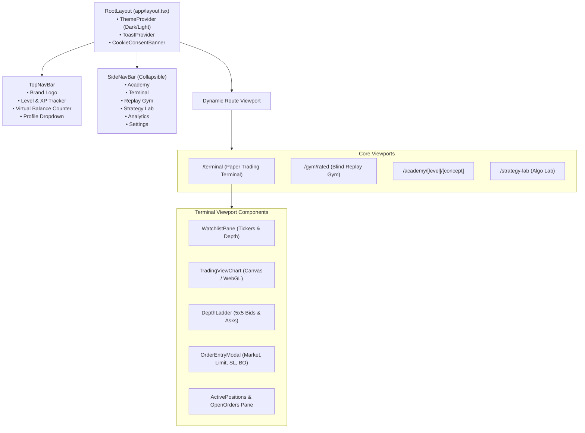
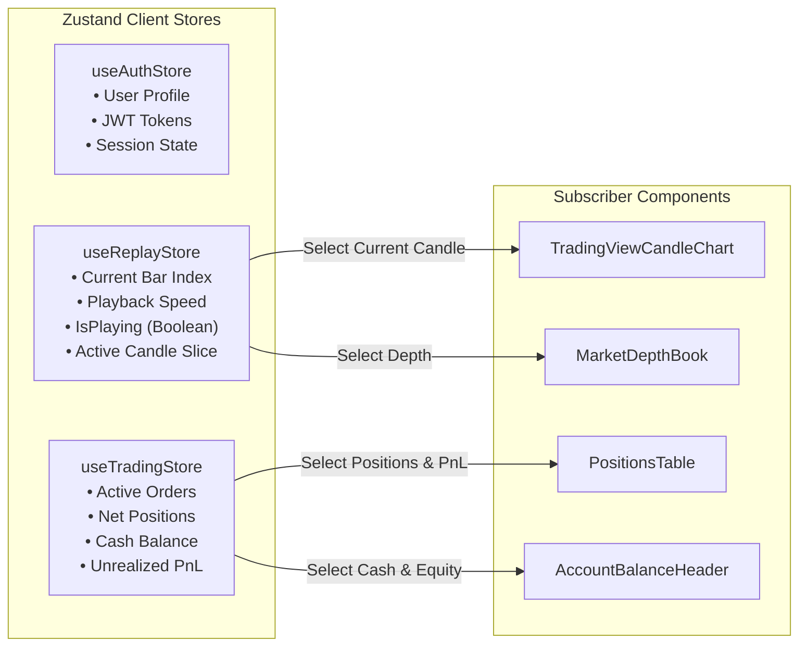
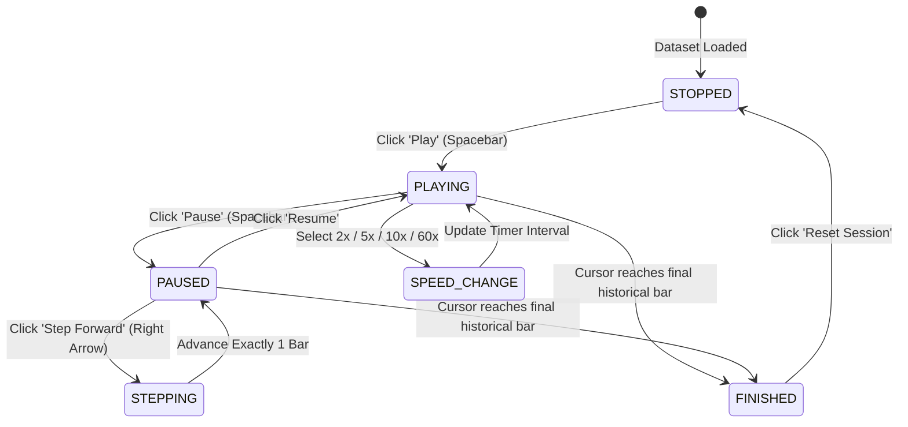

# Frontend Architecture Specification
## Project: MarketMaster Academy
**Framework**: Next.js 15 (App Router), React 19, TypeScript 5.5+, Tailwind CSS v4  
**Version**: 1.1.0  

---

### 1. Component Hierarchy & Layout Tree

---

### 2. Client-Side State Management (Zustand Flowchart)

---

### 3. Replay Playback Engine State Machine

