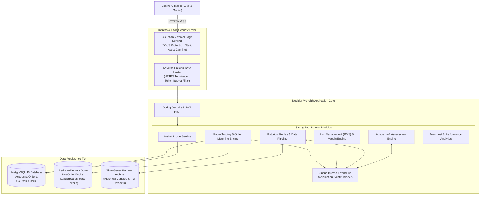
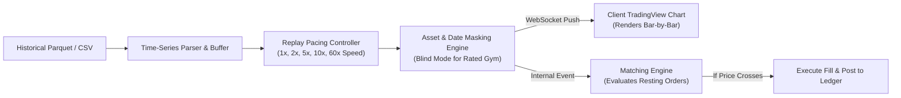
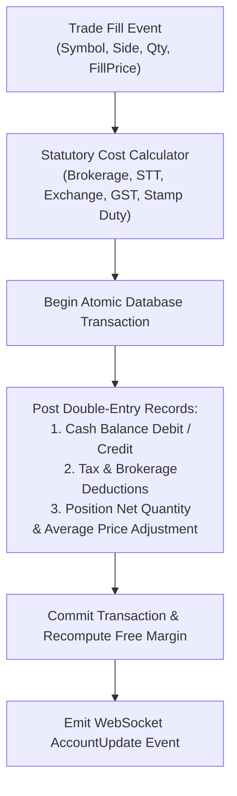
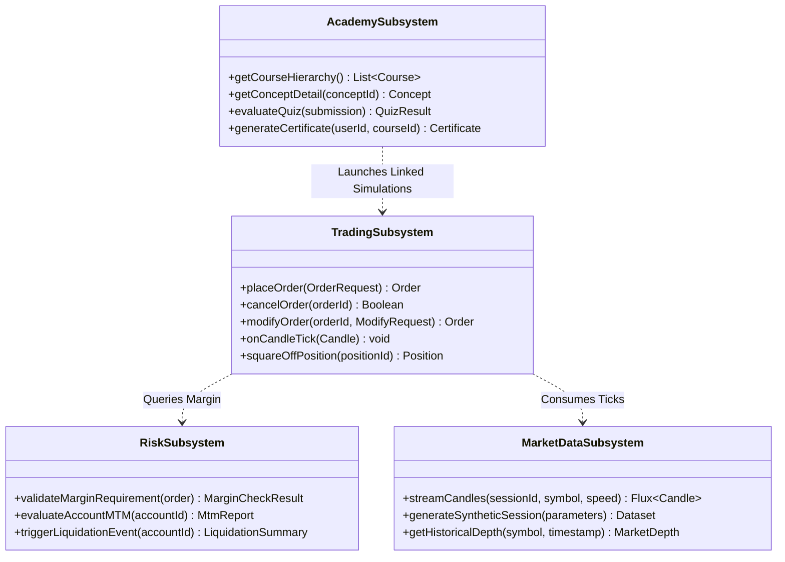

# High-Level Design (HLD)
## Project: MarketMaster Academy
**Architecture Pattern**: Event-Driven Modular Monolith with Virtual Threads  
**Version**: 1.1.0  

---

### 1. Architectural System Context & Ingress Routing

---

### 2. High-Level Data Pipelines

#### 2.1 Historical Candle Replay Pipeline
The replay engine streams historical candles to the client while simultaneously triggering pending order evaluations in the matching engine.

#### 2.2 Double-Entry Accounting Pipeline
Every fill or corporate adjustment triggers an atomic multi-step ledger posting:

---

### 3. Subsystem Detailed Responsibilities

