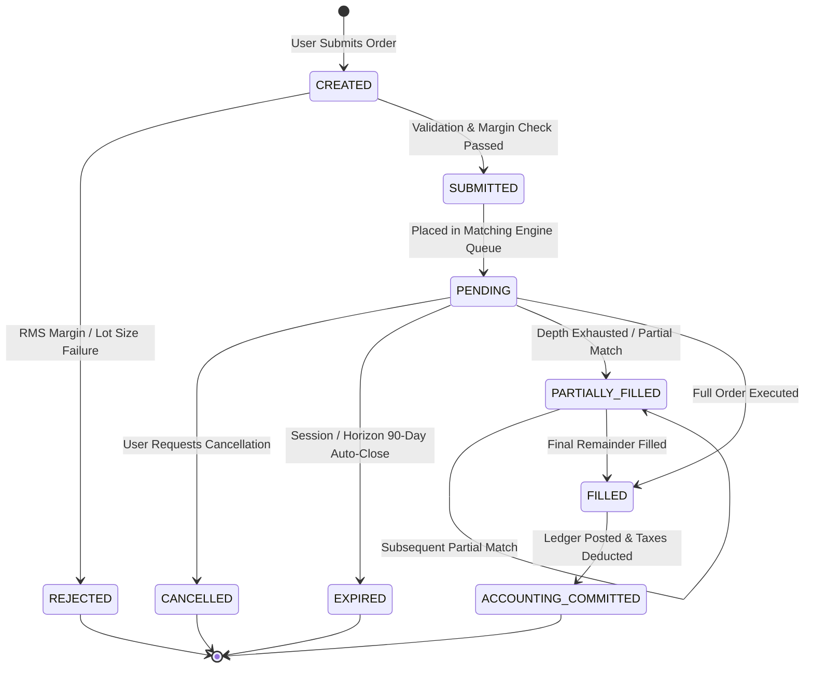
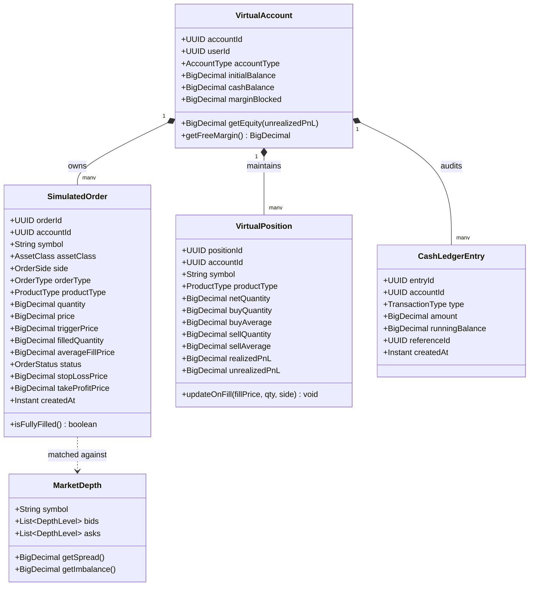
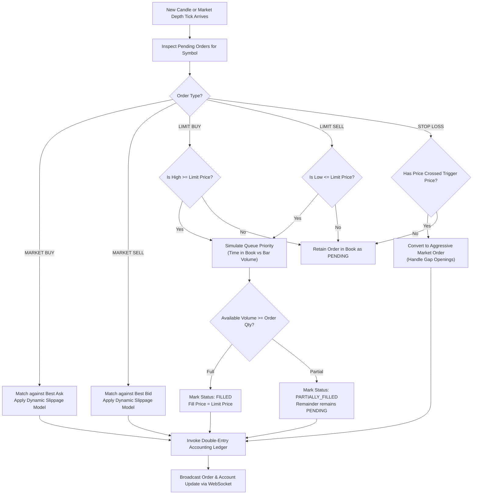

# Low-Level Design (LLD)
## Project: MarketMaster Academy
**Component**: Core Matching Engine, State Machine & Domain Models  
**Language/Framework**: Java 21 LTS / Spring Boot 3.3 / TypeScript / Kotlin  
**Version**: 1.1.0  

---

### 1. Order Lifecycle State Machine (`stateDiagram-v2`)

The order lifecycle strictly enforces deterministic state transitions. No illegal transitions (e.g. from `CANCELLED` to `FILLED`) are mathematically possible.

---

### 2. Comprehensive Domain Class Diagram (`classDiagram`)

---

### 3. Detailed Matching Engine Algorithm Flowchart

---

### 4. Dynamic Algorithmic Slippage Formula & Derivation

In production equity and derivatives markets, large retail market orders deplete order book liquidity, resulting in execution at prices inferior to the quoted top-of-book. MarketMaster Academy implements a non-linear power-law market impact model:

$$\text{Impact Ticks} = \max\left(1, \left\lfloor \alpha \times \left(\frac{Q_{\text{order}}}{V_{\text{bar}} \times \kappa}\right)^{\beta} \times \frac{\text{ATR}_{14}}{\text{Tick Size}}\right\rfloor\right)$$

* $Q_{\text{order}}$: Quantity requested by the trader.
* $V_{\text{bar}}$: Total volume executed in the current bar.
* $\kappa$: Top-of-book participation factor ($\kappa = 0.02$, representing 2% of bar volume resting in top 3 depth tiers).
* $\alpha$: Volatility scaling constant ($\alpha = 0.15$ for Equities, $\alpha = 0.25$ for Options).
* $\beta$: Non-linear elasticity exponent ($\beta = 0.65$, representing concave price impact).
* $\text{ATR}_{14}$: 14-period Average True Range of the instrument.
* $\text{Tick Size}$: ₹0.05 for NSE Equities/Indices.
