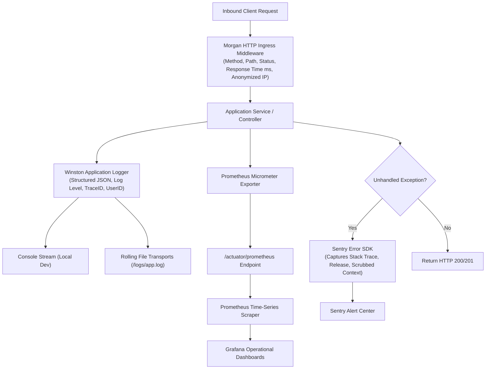
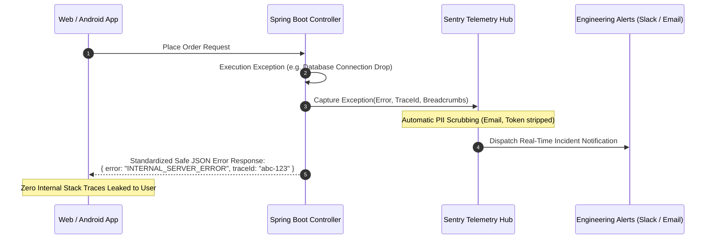

# Observability, Logging & Monitoring Specification
## Project: MarketMaster Academy
**Tools**: Winston, Morgan, SLF4J, Prometheus, Grafana, Sentry, PostHog  
**Version**: 1.1.0  

---

### 1. Dual-Layer Logging & Telemetry Pipeline

---

### 2. Error Reporting & Triage Sequence Diagram

