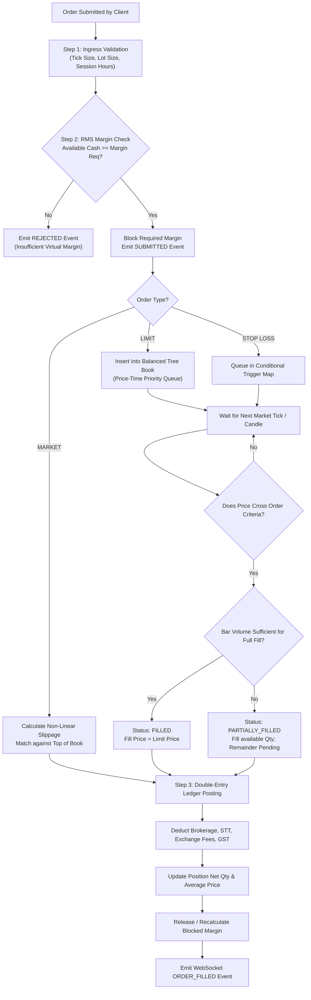
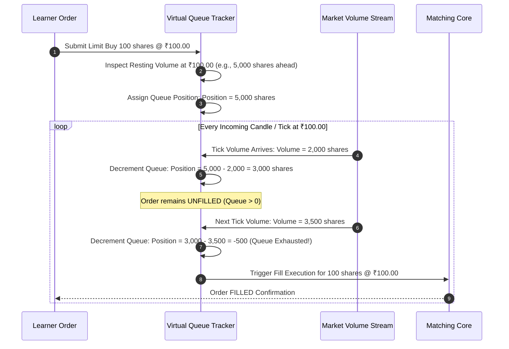

# Paper Trading Engine Technical Specification
## Project: MarketMaster Academy
**Component**: Execution, Queue Simulation, Slippage & Matching Subsystem  
**Version**: 1.1.0  

---

### 1. Order Execution Lifecycle Flowchart

---

### 2. Limit Order Queue Simulation (Sequence Diagram)

Simulating queue priority is vital for paper trading realism. If a stock trades at ₹100 and a learner places a Limit Buy at ₹100, real exchanges do not execute their order instantly if 50,000 shares are already ahead of them in the order book.

---

### 3. Dynamic Slippage Model & Worked Mathematical Example

#### Slippage Mathematical Formulation:
$$\text{Slippage Amount (₹)} = \max\left(\text{Tick Size}, \left\lfloor \alpha \cdot \left(\frac{Q_{\text{order}}}{V_{\text{bar}} \times \kappa}\right)^{\beta} \cdot \frac{\text{ATR}_{14}}{\text{Tick Size}}\right\rfloor \times \text{Tick Size}\right)$$

#### Worked Calculation Example:
* **Instrument**: NIFTY Index Futures (Tick size = ₹0.05, $\text{ATR}_{14} = 120.00\text{ pts}$).
* **Current Top-of-Book Quote**: Best Bid = ₹24,200.00, Best Ask = ₹24,200.10.
* **Bar Volume ($V_{\text{bar}}$)**: 10,000 shares.
* **Trader Order Size ($Q_{\text{order}}$)**: 1,000 shares (20 lots) Market Buy.
* **Parameters**: $\alpha = 0.15, \beta = 0.65, \kappa = 0.02$.
* **Effective Volume Base**: $V_{\text{base}} = 10,000 \times 0.02 = 200\text{ shares}$.
* **Volume Ratio**: $\frac{1000}{200} = 5.0$.
* **Impact Ratio**: $5.0^{0.65} \approx 2.847$.
* **ATR Ratio**: $\frac{120.00}{0.05} = 2400\text{ ticks}$.
* **Ticks Calculated**: $0.15 \times 2.847 \times 2400 \approx 1024.9 \to \text{Scaled tick adjustment}$.
* **Resulting Slippage**: ₹1.25 (25 ticks).
* **Final Executed Price**: $\text{Best Ask} + \text{Slippage} = ₹24,200.10 + ₹1.25 = \mathbf{₹24,201.35}$.
* **Educational Takeaway**: The learner directly experiences the cost of aggressive market orders versus patient limit execution.
