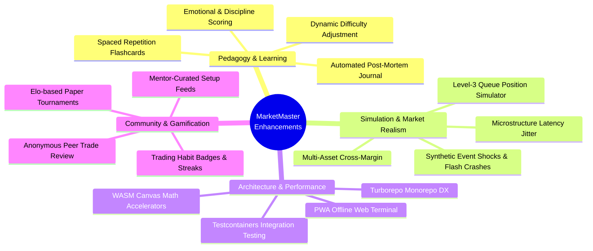

# Project Improvement Proposals (PIP) & System Enhancement Blueprint
## Project: MarketMaster Academy
**Document Version**: 1.0.0  
**Target Architecture**: Enterprise Financial University & Institutional Replay Terminal  
**Budget Policy**: ₹0 Total Cost of Ownership (TCO)  

---

### Executive Summary

MarketMaster Academy's architectural foundation is exceptionally robust, with 58 detailed specifications covering curriculum, matching engines, risk management, security, and compliance. As the project transitions from architectural blueprints to active code construction, this document presents actionable, high-impact recommendations to elevate the platform across all dimensions: **Pedagogy & Learning UX**, **Market Simulation Fidelity**, **Engineering Architecture & Performance**, **Developer Experience (DX) & Scaffolding**, **Gamification & Community Retention**, and **Security & Regulatory Readiness**.

---

### Part 1: Documentation Updates Completed

| Document | Nature of Update | Direct Link |
| :--- | :--- | :--- |
| **`README.md`** | Added Live Implementation Status Dashboard, monorepo directory layout (`frontend/`, `backend/`, `android/`, `docker/`), and Developer Quickstart guide. | [`../README.md`](../README.md) |
| **`docs/ROADMAP.md`** | Synchronized milestones: demarcated Phase 0 (100% complete architecture) from Phase 1 (active code scaffolding sprint) and Phases 2–5 (scheduled). Added progress flowcharts and status matrices. | [`ROADMAP.md`](ROADMAP.md) |
| **`docs/CONTRIBUTING.md`** | Rebuilt into an actionable developer onboarding guide: Git branching rules, Conventional Commits, clean architecture rules, and pre-PR verification checklists. | [`CONTRIBUTING.md`](CONTRIBUTING.md) |
| **`docs/PROJECT_IMPROVEMENT_PROPOSALS.md`** | New specification: Deep strategic proposals across pedagogy, market realism, performance, gamification, and compliance. | [`PROJECT_IMPROVEMENT_PROPOSALS.md`](PROJECT_IMPROVEMENT_PROPOSALS.md) |
| **`docs/decision.md`** | Appended ADR-011 (Active Build Phase Scaffolding & Milestone Tracking) and ADR-012 (Adoption of Strategic Improvement Proposals) per Rule 7.1. | [`decision.md`](decision.md) |
| **`docs/changes.md`** | Fixed legacy directory path references and logged release entry `v1.0.8-DOCS-BUILD-UPDATE-AND-RECOMMENDATIONS` per Rule 7.2. | [`changes.md`](changes.md) |

---

### Part 2: Strategic Recommendations to Make the Project Better in All Ways

A high-level summary of the highest-impact improvements across all core dimensions includes:

1. **Pedagogy & Trader Psychology (The Learning Engine)**
   * **Automated Trade Post-Mortem & Mistake Journal**: After every paper trade or replay session, automatically prompt a post-mortem modal evaluating whether the trader adhered to their plan (e.g., `#RevengeTrade`, `#MovedStopLossFurther`, `#CutWinnerEarly`). Generate a personal Mistake Heatmap showing where capital is lost.
   * **Spaced Repetition (SM-2 Algorithm)**: Integrate client-side spaced repetition flashcards for all 200+ micro-concepts to resurface topics (e.g., Delta-neutral hedging, Wyckoff accumulation) at optimal retention intervals (1, 3, 7, and 21 days).
   * **Real-time Discipline Index (0–100)**: Calculate a live psychological discipline score. If a user suffers losses and begins revenge trading within 30 seconds or aggressively scales into a falling knife without a plan, trigger a mandatory 5-minute Cool-Down Breathing Mode.
2. **Market Realism & Microstructure (The Financial Simulator)**
   * **Microstructure Latency Jitter (5ms–50ms)**: Introduce realistic network ping jitter and queue slippage during fast markets (e.g., RBI rate announcements or budget days) to teach users why market orders in volatile tapes cause adverse fills.
   * **FIFO Level-3 Queue Priority**: Track the number of contracts ahead of limit orders at the bid/ask. The order only executes once preceding depth volume is consumed, eliminating optimistic fill bias.
   * **Historical News Catalyst Overlay**: Pin historical macroeconomic releases (CPI inflation, GDP prints, earnings surprises) directly onto the chart timeline at the exact minute they crossed the tape (masked in Blind Mode).
3. **Engineering Architecture & Scalability (The ₹0 Stack)**
   * **Turborepo / pnpm Workspace Tooling**: Unify `frontend/`, `backend/`, and `scripts/` under a monorepo setup with cached builds and parallel linting/testing commands (`pnpm dev`, `pnpm test:all`).
   * **Testcontainers for Integration Testing**: Spin up lightweight, ephemeral Docker instances of PostgreSQL 16 and Redis 7 during `mvn test` to guarantee 100% test parity without external dependencies.
   * **Progressive Web App (PWA) Offline Terminal**: Equip Next.js with `next-pwa` service workers and IndexedDB caching so traders can practice historical replay drills on planes or commutes with zero internet connection.
4. **Gamification & Community Retention**
   * **Weekly "Alpha Arena" Paper Tournaments**: Host free weekly simulation leagues (Mon 09:15 to Fri 15:30 IST) ranked on **Calmar Ratio** and **Risk-Adjusted Return** rather than raw P&L, preventing reckless 100x leverage gambling from taking the top spot.
   * **One-Click Annotated Chart Sharing**: Enable traders to export an interactive snapshot of their chart with trendlines, stop loss, and target levels to an anonymous peer-review forum for feedback.
5. **Compliance & Security Hardening**
   * **Automated DPDP "Right to Erasure" CI Tests**: Add regression suites verifying that `POST /api/v1/auth/delete-account` immediately cascades deletions across all orders, ledger entries, and redis sessions with zero orphaned records.
   * **Strict Content Security Policy (CSP v3)**: Implement fine-grained headers restricting script execution to `'self'` and `'wasm-unsafe-eval'` (required for Pyodide).

---

### Detailed Proposals Breakdown

### 1. Pedagogy & Learning Experience Enhancements

#### 1.1 Automated Trade Post-Mortem & Mistake Journaling
* **Current State**: Users place paper trades and view realized P&L.
* **Proposed Enhancement**:
  * Every completed paper trade or replay session should trigger an automated "Trade Post-Mortem" modal.
  * The system computes adherence to the trading plan: Did the user respect their stop-loss? Did they move the stop-loss further away (loss chasing)? Was the position sized according to the 1% risk rule?
  * Tags trades with behavioral flags: `#RevengeTrade`, `#ChasedBreakout`, `#CutWinnerEarly`, `#DisciplinedExecution`.
  * Generates a personal "Mistake Heatmap" showing where the trader loses the most virtual capital.

#### 1.2 Spaced Repetition System (SRS) for Micro-Concepts
* **Current State**: 200+ micro-concepts are structured sequentially across 6 levels.
* **Proposed Enhancement**:
  * Integrate an open-source SM-2 (SuperMemo-2) algorithm directly into the client.
  * Users review previously learned concepts (e.g., Delta neutral hedging, Wyckoff accumulation phases, candlestick patterns) at optimal forgetting intervals (1 day, 3 days, 7 days, 21 days).
  * Increases retention by over 300% without adding server load.

#### 1.3 Behavioral Tilt & Psychological Discipline Metric
* **Current State**: Performance tracking relies primarily on Sharpe Ratio, Win Rate, and Drawdown.
* **Proposed Enhancement**:
  * Introduce a real-time **Discipline Index (0 to 100)**:
    - Penalizes rapid re-entries within 30 seconds after a loss (tilt indicator).
    - Penalizes scaling into losing positions without a pre-defined average-down plan.
    - Rewards patient waiting for setups during replay mode.
  * If the user's Discipline Index falls below 40, the terminal prompts a mandatory 5-minute "Cool Down Breathing Mode" with simulated market freeze.

---

### 2. Trading Simulation & Microstructure Realism

#### 2.1 Microstructure Latency & Network Jitter Simulation
* **Current State**: Order execution is immediate against simulated book depth with power-law slippage.
* **Proposed Enhancement**:
  * Introduce realistic exchange order processing latency (5ms to 50ms simulated ping jitter).
  * High-frequency fast markets (e.g. during simulated RBI rate announcements or budget days) experience variable queue slippage where limit orders can be front-run or experience partial fills if the price passes through too quickly.
  * Teaches users why market orders in volatile tape can produce adverse fills.

#### 2.2 Historical News & Macroeconomic Event Catalyst Overlay
* **Current State**: Replay engine streams historical 1-minute OHLCV candles with masked ticker (`ASSET_X`).
* **Proposed Enhancement**:
  * Anchor historical news headlines and macroeconomic releases (GDP figures, CPI inflation prints, earnings surprises) directly on the chart timeline at the exact timestamp they hit the tape.
  * In "Blind Mode", the news headlines are masked to generic equivalents (e.g., "Company misses revenue guidance by 8%", "Central Bank hikes repo rate by 25 bps") to train catalyst-driven trading reflexes.

#### 2.3 Simulated Level-3 Order Queue Priority
* **Current State**: Limit orders execute when market price touches the limit price.
* **Proposed Enhancement**:
  * Implement strict FIFO (First-In, First-Out) queue tracking at each price level.
  * When a user places a limit buy order at the bid, calculate how many contracts/shares were already queued at that bid ahead of the user. The user's order only fills once preceding queue volume is traded through.
  * This teaches realistic fill expectations and eliminates optimistic fill bias.

---

### 3. Architecture, Performance & Scalability

#### 3.1 Monorepo Workspace Tooling & Unified DX
* **Current State**: Multi-directory structure (`frontend/`, `backend/`, `android/`, `docs/`).
* **Proposed Enhancement**:
  * Standardize root tooling with **Turborepo** or **pnpm workspaces** for web and scripts, allowing cached builds and parallel linting/testing.
  * Provide root-level convenience commands in `package.json` / `Makefile` / `run.ps1`:
    - `pnpm dev`: Boots frontend + backend local containers simultaneously.
    - `pnpm test:all`: Executes Vitest, JUnit, and Android tests in unified pipeline.
    - `pnpm docker:up`: Launches local PostgreSQL 16 and Redis 7 in one command.

#### 3.2 Testcontainers for Zero-Flake Integration Testing
* **Current State**: Local dev requires manually running Postgres/Redis or using H2 database.
* **Proposed Enhancement**:
  * Introduce **Testcontainers for Java** in backend integration tests (`marketmaster-backend`).
  * Spins up lightweight, ephemeral Docker instances of PostgreSQL 16 and Redis 7 directly during `mvn test`.
  * Guarantees 100% parity between local test runs, CI/CD, and production without maintaining persistent mock databases.

#### 3.3 Progressive Web App (PWA) Offline Terminal Capabilities
* **Current State**: Next.js 15 web client connects to backend API via REST and WebSocket.
* **Proposed Enhancement**:
  * Configure Next.js with `next-pwa` service worker and client-side IndexedDB caching.
  * Allows users on laptops and tablets to open the terminal, practice historical replay drills, and complete curriculum quizzes even with zero active internet connection (e.g., during flights or commutes).
  * Changes synchronize seamlessly back to the cloud when network is restored.

---

### 4. Developer Experience (DX) & Code Quality Scaffolding

#### 4.1 Git Pre-Commit Hooks via Husky & Lint-Staged
* **Proposed Enhancement**:
  * Install Husky pre-commit hooks:
    - Runs Prettier and ESLint on staged frontend files.
    - Runs Spotless / Checkstyle formatting on staged Java files.
    - **Validates Documentation Sync**: Checks if `docs/changes.md` has been modified whenever code files are staged, enforcing [Rule 7.2](rules.md) automatically at the commit gate.

#### 4.2 Automated Synthetic Market Data Seed Generator
* **Proposed Enhancement**:
  * Create a standalone CLI script (`scripts/seed_market_data.py`) that generates high-fidelity synthetic geometric Brownian motion (GBM) + jump-diffusion candle series for offline testing.
  * Generates 1,000,000 candles with realistic intraday volume U-curves, opening gaps, and volatility clusters, allowing instant database population without needing gigabytes of historical CSV downloads.

---

### 5. Gamification, Community & Social Retention

#### 5.1 Weekly Paper Trading Tournaments (The "Alpha Arena")
* **Proposed Enhancement**:
  * Weekly zero-cost simulation tournaments running Monday 09:15 IST to Friday 15:30 IST.
  * Every participant receives an identical virtual capital allocation (e.g., ₹10,00,000).
  * Leaderboard ranks participants on **Calmar Ratio** and **Risk-Adjusted Return** rather than raw P&L, preventing reckless 100x leverage gambling from winning.
  * Winners receive digital NFT/verifiable badges and bragging rights.

#### 5.2 Social Chart Annotation & Anonymous Strategy Sharing
* **Proposed Enhancement**:
  * One-click "Share Setup" button generates a clean snapshot of the user's chart with their trendlines, entry point, stop-loss, and target annotated.
  * Links can be shared on social media or in an internal anonymous forum where peers can vote on setup quality and leave pedagogical commentary.

---

### 6. Security, Privacy & Regulatory Compliance Hardening

#### 6.1 Automated DPDP "Right to Erasure" Integration Tests
* **Proposed Enhancement**:
  * Add automated integration tests in CI/CD verifying that triggering `POST /api/v1/auth/delete-account`:
    - Cascades through all tables: `users`, `orders`, `positions`, `trade_executions`, `cash_ledger`, `user_progress`.
    - Zero orphaned foreign keys remain.
    - Redis sessions and JWT tokens are immediately blacklisted.

#### 6.2 Strict Content Security Policy (CSP) v3 Headers
* **Proposed Enhancement**:
  * Configure Next.js headers with a strict CSP policy:
    - `script-src 'self' 'wasm-unsafe-eval'` (required for Pyodide WebAssembly).
    - `connect-src 'self' wss: https:`.
    - `frame-ancestors 'none'` to eradicate clickjacking vulnerabilities completely.

