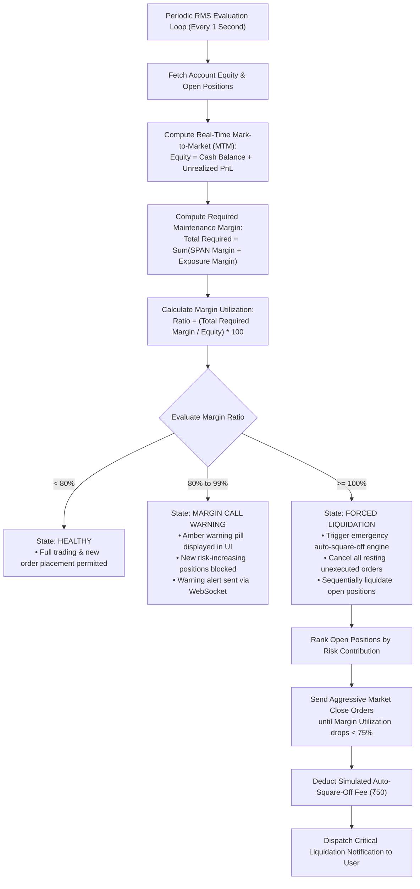
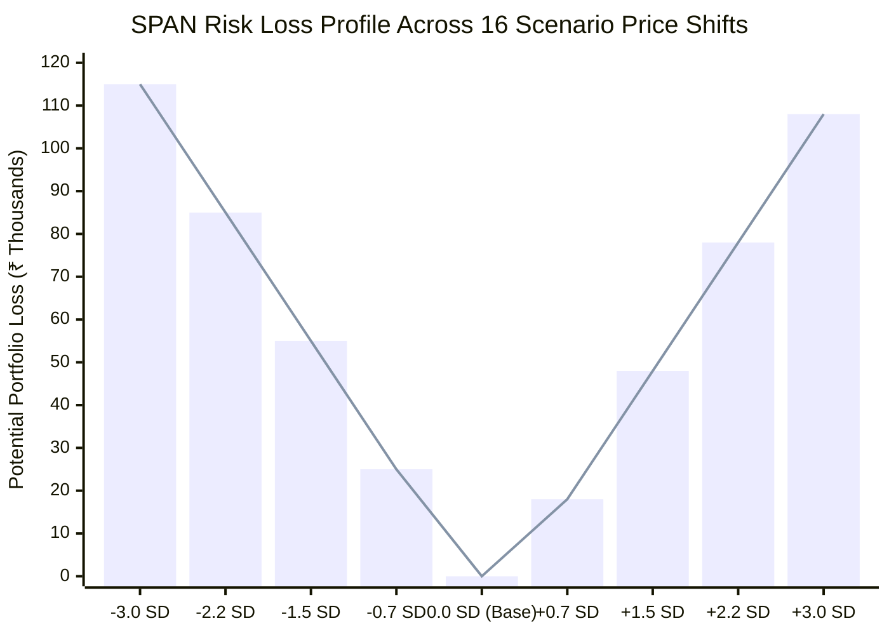
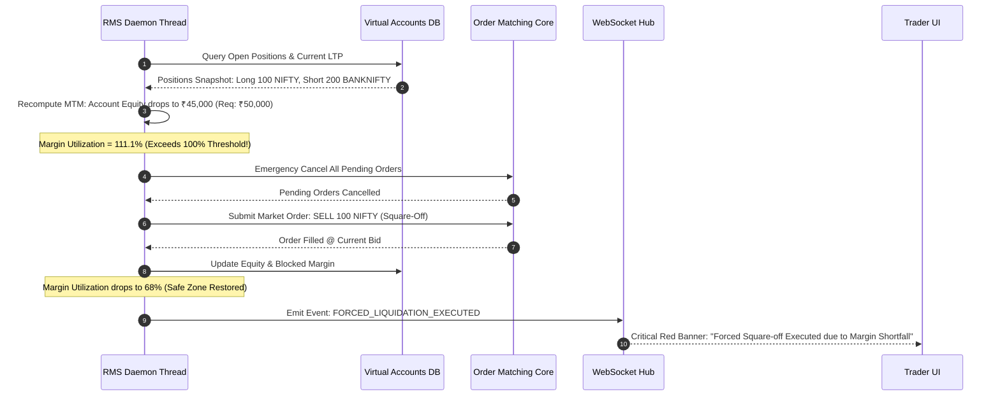

# Risk Management System (RMS) Technical Specification
## Project: MarketMaster Academy
**Author**: Quantitative Risk & RMS Committee  
**Version**: 1.1.0  

---

### 1. RMS Margin Monitoring & Liquidation Lifecycle

---

### 2. Multi-Scenario SPAN Margin Risk Matrix

In accordance with official Indian exchange (NSE Clearing) regulations, derivatives margin is calculated across 16 extreme price and implied volatility shift scenarios:

* **Maximum Scan Loss**: The worst-case loss across all 16 scenarios determines the base SPAN requirement.
* **Calendar Spread Benefit**: Offsetting near-month and far-month positions receive an 80% margin relief discount to simulate institutional capital efficiency.

---

### 3. Forced Liquidation Sequence Diagram

