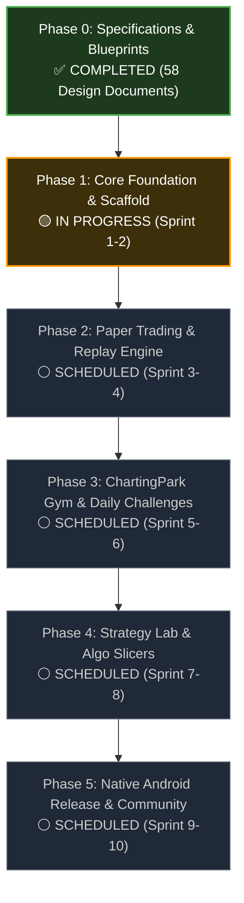

# Product Development & Build Roadmap
## Project: MarketMaster Academy
**Phased Release Schedule**: From Architectural Blueprint to Full Multi-Asset Educational Ecosystem  
**Last Updated**: 2026-11-04  
**Lifecycle Status**: Phase 0 Complete (Architecture & Specifications) ➔ Phase 1 In Progress (Core Foundation & Implementation Scaffolding)

---

### Implementation Progress Overview

---

### Phase-by-Phase Deliverables & Status Matrix

| Phase | Milestone Name | Architecture / Specs | Code Implementation | Target Status |
| :--- | :--- | :---: | :---: | :--- |
| **Phase 0** | Comprehensive Architectural & Regulatory Blueprint | ✅ Complete (100%) | N/A (Spec phase) | **COMPLETED** |
| **Phase 1** | Core Foundation, Scaffold & Database Engine | ✅ Complete (100%) | 🟡 In Progress (30%) | **ACTIVE SPRINT** |
| **Phase 2** | Paper Trading, Order Book & Candle Replay Engine | ✅ Complete (100%) | ⚪ Pending | **SCHEDULED** |
| **Phase 3** | ChartingPark Gym, Rated Mode & Daily Challenges | ✅ Complete (100%) | ⚪ Pending | **SCHEDULED** |
| **Phase 4** | Strategy Lab, Algo Slicers & Pyodide WASM | ✅ Complete (100%) | ⚪ Pending | **SCHEDULED** |
| **Phase 5** | Native Android App (Compose) & Multi-Language | ✅ Complete (100%) | ⚪ Pending | **SCHEDULED** |

---

### Detailed Phase Breakdown

#### Phase 0: System Architecture & Specification Suite (Completed)
- [x] Full IEEE 830 SRS, BRD, PRD, HLD, LLD, and C4 architecture diagrams.
- [x] Complete PostgreSQL database schema (DDL), compound index plans, and ERD.
- [x] OpenAPI 3.1 REST specifications and WebSocket ticker protocol contracts.
- [x] Comprehensive 6-level curriculum mapped across 24 domains and 200+ micro-concepts.
- [x] Legal frameworks: Terms of Service, Privacy Policy (DPDP 2023/GDPR), Cookie Policy, Refund Policy.
- [x] Living governance tracking: `rules.md`, `decision.md` (ADR log), and `changes.md`.

#### Phase 1: Core Foundation & Scaffold (Active Sprint)
*Target: Establish working monorepo/multi-service repository, local container infrastructure, auth engine, and database migrations.*
- [x] Architecture & component contracts specified.
- [ ] Monorepo workspace scaffolding (`frontend/`, `backend/`, `android/`, `docker/`).
- [ ] Docker Compose environment (`PostgreSQL 16` + `Redis 7` on ₹0 local stack).
- [ ] Flyway database migrations (`V1__init_schema.sql` based on `DATABASE_SCHEMA.md`).
- [ ] Spring Boot 3.3 / Java 21 core application setup with Virtual Threads (Project Loom).
- [ ] JWT authentication filter, refresh-token rotation, and BCrypt password hashing.
- [ ] Next.js 15 (React 19) web client shell with Tailwind CSS dark-mode trading theme.
- [ ] Compounding, Option Payoff, and Position Sizing financial calculator utilities.

#### Phase 2: Paper Trading & Replay Engine (Scheduled)
*Target: High-fidelity historical candle replay and realistic Indian exchange simulation.*
- [ ] TradingView Lightweight Charts integration with custom indicators and drawing tools.
- [ ] Historical 1-minute candle replay pipeline with speed controls (0.5x to 10x) and jump-to-date.
- [ ] Blind Mode ticker masker (`ASSET_X`, randomized timestamp offsets) to eradicate hindsight bias.
- [ ] In-memory limit order book matching engine with depth ladder (Level 2 quotes).
- [ ] Realistic slippage model (power-law slippage dependent on order size vs top-of-book depth).
- [ ] Double-entry bookkeeping ledger (`cash_ledger` table) with automated STT, GST, and Stamp Duty deductions.
- [ ] Pre-trade Risk Management System (RMS) checks for SPAN and exposure margin.

#### Phase 3: ChartingPark Gym & Daily Challenges (Scheduled)
*Target: Gamified deliberate practice, skill ranking, and competitive daily drills.*
- [ ] Rated Replay Mode with Glicko-2 rating engine and mandatory risk-reward stop losses.
- [ ] Daily Challenge generator: 3 curated historical chart setups refreshed daily at 00:00 UTC.
- [ ] Global and regional leaderboard based on risk-adjusted expectancy and discipline scores.
- [ ] Micro-session pattern recognition drills (Breakout vs False Breakout, Divergence, Order Blocks).
- [ ] Real-time performance analytics: Win rate, Profit Factor, Sharpe Ratio, Maximum Drawdown curve.

#### Phase 4: Strategy Lab & Algo Slicers (Scheduled)
*Target: Client-side Python algorithmic sandbox and institutional execution algorithms.*
- [ ] Browser-based Pyodide (Python WebAssembly) execution sandbox for zero-server-cost backtesting.
- [ ] Vectorized backtesting engine using Pandas/Numpy loaded in browser memory.
- [ ] Institutional execution slicers:
  - Time-Weighted Average Price (TWAP)
  - Volume-Weighted Average Price (VWAP)
  - Percentage of Volume (POV)
  - Iceberg slicing with randomized display lot sizes
  - Cash-Futures Cash-and-Carry Arbitrage simulator
- [ ] Interactive tear-sheet generator: Equity curves, monthly returns heatmap, rolling volatility.

#### Phase 5: Native Android Release & Community (Scheduled)
*Target: Native mobile distribution and localization.*
- [ ] Android native app with Jetpack Compose, Material Design 3, and Kotlin Coroutines/Flow.
- [ ] Offline-first synchronization using Room database for offline learning and practice drills.
- [ ] Biometric authentication (Fingerprint / Face Unlock) for rapid terminal access.
- [ ] GitHub Actions CI/CD pipeline for automated APK builds and GitHub Releases distribution.
- [ ] Multi-lingual localization: English, Hindi (हिंदी), and Marathi (मराठी).
- [ ] Anonymous peer discussion forums and chart annotation sharing.

---

### Definition of Done (DoD) per Phase
1. **Zero-Cost Invariant**: All code and services must run without incurring recurring hosting or API fees.
2. **Quality & Coverage**: Minimum 85% branch test coverage on trading, accounting, and matching engine modules.
3. **Traceability**: All architectural changes recorded in `docs/decision.md`; all commits and modifications documented in `docs/changes.md`.
4. **Security**: Passes OWASP Top 10 automated scans with zero critical or high vulnerabilities.
