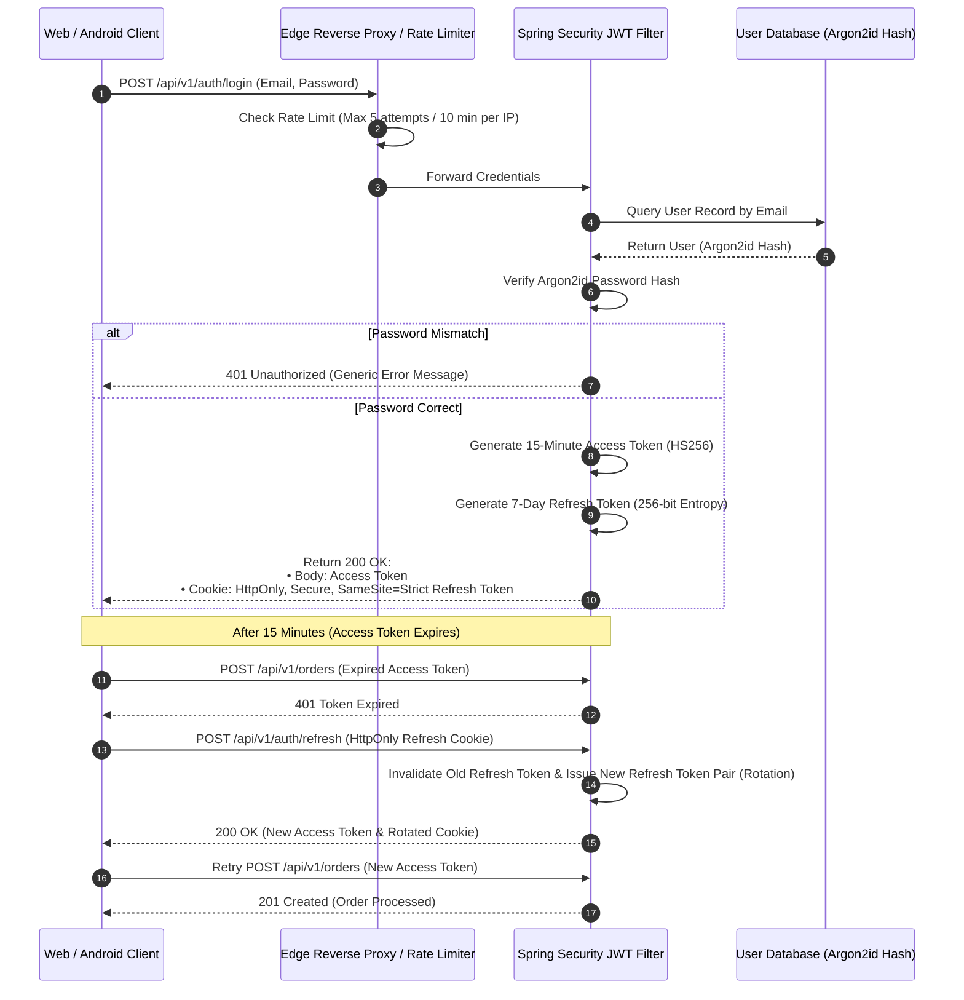
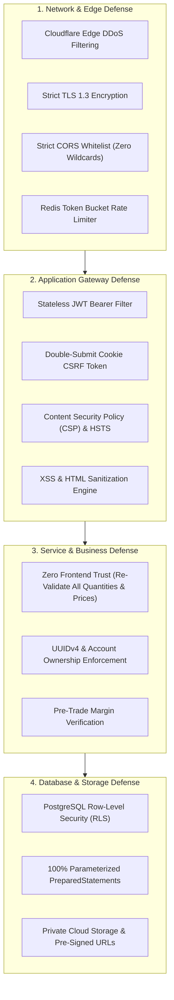

# Security Hardening & API Protection Specification
## Project: MarketMaster Academy
**Standard**: Comprehensive Defensive Engineering & Zero-Trust Architecture  
**Version**: 1.1.0  

---

### 1. Zero-Trust Authentication & Token Rotation Sequence

---

### 2. Multi-Layer Defensive Security Invariants

